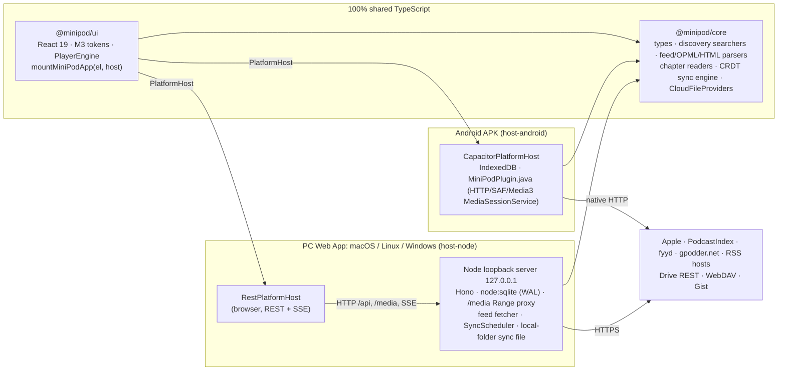
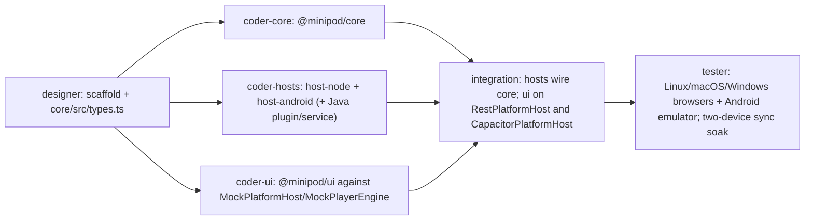

# MiniPod — Architecture (v2: 100 % TypeScript, Android + PC Web App)

> Companion to [DESIGN.md](DESIGN.md). This document is the build contract for the packages of the `minipod` pnpm monorepo, modelled on Kotori (`/usr/local/google/home/chii/Developer/kotori`): **one shared core, one shared UI, two hosts** (`host-node` for the PC Web App on macOS / Linux / Windows, `host-android` for a standalone Capacitor APK). Everything that crosses a package boundary is typed in [`packages/core/src/types.ts`](packages/core/src/types.ts) — it is the law.
> AntennaPod class names cited below refer to the upstream repo and are documented in [docs/ANTENNAPOD_SOURCES.md](docs/ANTENNAPOD_SOURCES.md).

---

## 0. Ground rules (apply to every package)

| Rule | Detail |
|---|---|
| **Toolchain** | Node `>=22.5.0` (built-in `node:sqlite` `DatabaseSync`, global `fetch`, `crypto.subtle`), pnpm 10 (`packageManager: pnpm@10`), TypeScript 5.9 (`strict`, `exactOptionalPropertyTypes`, `noUncheckedIndexedAccess`, `verbatimModuleSyntax`), Vitest 4, Vite 7, React 19, Capacitor 8. |
| **Zero native addons** | `pnpm-workspace.yaml`: `onlyBuiltDependencies: []` (pnpm refuses to run any dependency build script) + `overrides` deleting `better-sqlite3`, `sqlite3`, `sharp`, `canvas`, `bufferutil`, `utf-8-validate`, `node-datachannel`. `pnpm check:native` (`scripts/check-native-deps.mjs`) scans the production tree of `@minipod/host-node` + `@minipod/core` for `.node` / `binding.gyp` / `node-gyp-build` / `prebuild-install` and fails CI. No `fast-xml-parser` native variants, no `sqlite3`, no `ffmpeg`: feed parsing, chapter parsing and sync are pure TS. Dev-only prebuilt executables (esbuild / rollup platform packages) are acceptable; never shipped at runtime. |
| **Imports** | Extensionless relative imports, `moduleResolution: Bundler`. Workspace packages are consumed **as TypeScript source** (`main: ./src/index.ts`); no build step is needed for typecheck/tests. |
| **`core` is platform-neutral** | No `node:*`, no DOM globals (`window`, `document`, `localStorage`, `DOMParser`), no Capacitor. Allowed globals: `fetch` *type* only (always injected), `TextDecoder/TextEncoder`, `crypto.subtle`, `AbortController`, `URL`, `Uint8Array`. Everything I/O-ish is injected (`HttpClient`, `now()`, `Store`, `Scheduler`, `TokenProvider`). |
| **Errors** | `MiniPodError(code, message, { details })` from `@minipod/core`; codes: `invalid-url`, `unsupported-feed`, `feed-not-found`, `auth-required`, `network`, `not-found`, `invalid-argument`, `sync-conflict`, `sync-auth`, `sync-schema`, `unsupported`, `cancelled`. Hosts serialise with `toShape()`, the REST client rebuilds with `fromShape()`; the UI switches on `error.code`. |
| **Tests** | Co-located `*.test.ts(x)`; `pnpm test` runs all projects; fixtures under `packages/<pkg>/test-fixtures/` (real-world feeds, Apple/PodcastIndex/fyyd/gpodder JSON, HTML pages, OPML, ID3/Ogg/MP4 chapter samples). Property tests for the CRDT merge. |
| **Verify before handoff** | `pnpm install && pnpm typecheck && pnpm test && pnpm check:native` green. |

## 1. System overview



**One UI, one contract, two hosts.** `packages/ui` never knows which platform it runs on beyond `host.info.capabilities` and the `PlayerEngine` it is handed. Desktop runs the UI in the user's browser (Chrome/Chromium/Edge `--app=` window when available, else default browser) against a local HTTP server that owns storage, networking, playback proxying and the sync scheduler — so sync keeps running while the browser tab is closed. Android runs the same UI inside a Capacitor WebView with an in-process host; audio is played by a native Media3 `MediaSessionService` driven from JS so playback, progress and sync survive the screen being off.

### 1.1 Dependency graph (enforced)

```
core         → (nothing in the workspace)     runtime deps: none (zod optional for schema validation)
ui           → core                            runtime deps: react, react-dom, zustand, @material/material-color-utilities
host-node    → core, ui (web entry only)       runtime deps: hono, @hono/node-server
host-android → core, ui                        runtime deps: @capacitor/{core,android,app,filesystem,preferences}, idb, react, react-dom
```

### 1.2 CORS, networking and playback per platform

| Concern | PC Web App (host-node) | Android (host-android) |
|---|---|---|
| Feed / search / cloud HTTP | All requests are made by the **Node server** (`GET /api/...` from the browser → server `fetch`). No CORS anywhere. The server sees the full redirect chain (`redirect: 'manual'` loop) and injects Basic Auth. | `window.fetch` in the WebView is CORS-bound, so core's `HttpClient` is implemented by **`MiniPodPlugin.http`** (OkHttp in Java): manual redirect following with the chain returned to JS, Basic Auth retry (ISO-8859-1 → UTF-8), `Range` support, streaming to file. `CapacitorHttp` is **not** enabled (it hides redirects and base64-encodes bodies). |
| Audio/video playback | `<audio>`/`<video>` element in the browser with `src = /media/{episodeKey}` — the server proxies the enclosure (or serves the downloaded file) with HTTP 206 Range, correct `Content-Type`, Basic Auth and redirects. Hardware keys / OS overlay via `navigator.mediaSession`. | **Native**: Media3 `ExoPlayer` inside a foreground `MediaSessionService` (notification, lockscreen, Bluetooth, Android Auto). JS controls it through `MiniPodPlugin` (`load/play/pause/seekTo/setSpeed`), receives `position`/`state`/`ended` events. Video enclosures render through a `SurfaceView` overlaid under a transparent WebView region (v1: audio track of video plays natively; inline video surface is P2). |
| Chapter byte-range reads | server `fetch` with `Range` | `MiniPodPlugin.http` with `Range`, body returned as base64 (≤ 2 MiB slices) |
| Local folder feeds | `node:fs` directory path | SAF tree URI (`ACTION_OPEN_DOCUMENT_TREE`) listed by `MiniPodPlugin.listTree`; media played natively from `content://` |
| Cloud sync file (zero-OAuth path) | **Local synced folder**: the user picks a folder already synced by the Google Drive / Dropbox / Syncthing / iCloud / OneDrive desktop client; the server reads/writes `minipod-sync-v1.json` there with `node:fs` and `fs.watch`es it | **SAF document**: `ACTION_OPEN_DOCUMENT` / `ACTION_CREATE_DOCUMENT` through `MiniPodPlugin.saf` with persistable URI permission |
| Background execution | Server process is always on while `minipod` runs; sync scheduler lives there | Foreground service keeps the process alive while playing; the WebView keeps running JS (Capacitor does not pause the WebView) but the native service additionally checkpoints position natively every 5 s as a safety net; when the app is killed the next launch reconciles |

## 2. Repository layout & ownership

```
minipod/
├── package.json                 root scripts: typecheck, test, build, lint, check:native, dev, start, build:apk, bump:version
├── pnpm-workspace.yaml          packages/* · onlyBuiltDependencies: [] · native overrides
├── tsconfig.base.json · vitest.config.ts (projects: packages/*)
├── scripts/check-native-deps.mjs · scripts/bump-version.mjs
├── DESIGN.md · ARCHITECTURE.md · docs/ANTENNAPOD_SOURCES.md
└── packages/
    ├── core/          @minipod/core          pure TS domain library (coder-core; src/types.ts: designer)
    ├── ui/            @minipod/ui            React 19 + M3 UI, mountMiniPodApp(el, host, engine) (coder-ui)
    ├── host-node/     @minipod/host-node     PC Web App runtime: Hono loopback server + RestPlatformHost (coder-hosts)
    └── host-android/  @minipod/host-android  Capacitor 8 APK: CapacitorPlatformHost + MiniPodPlugin.java (coder-hosts)
```

Root scripts mirror Kotori: `pnpm dev` (= `pnpm --filter @minipod/host-node dev`), `pnpm start` (`node bin/minipod.mjs`), `pnpm start:app` (`--new-browser`), `pnpm dev:ui` (mock-host harness), `pnpm build:apk` (`cap sync android && gradlew assembleRelease`).

### 2.1 Package map

```
packages/core/src/
├── types.ts                      ALL shared types + PlatformHost contract (§3)
├── errors.ts                     MiniPodError, toShape/fromShape
├── discovery/                    PodcastSearcher, PodcastSearcherRegistry, CombinedSearcher, ItunesSearcher, ItunesTopListLoader,
│                                 PodcastIndexSearcher, FyydSearcher, GpodderSearcher, FeedUrlResolver, UrlNormalizer
├── feed/                         xml/ (tolerant streaming XML tokenizer), TypeDetector, SyndParser, namespace/{Rss20,Atom,Rdf,Itunes,
│                                 PodcastIndex,Content,Media,SimpleChapters,DublinCore}, HtmlFeedDiscoverer, Opml (read/write), identity.ts
├── chapters/                     id3.ts, vorbis.ts, mp4.ts, psc.ts, podcastindex-json.ts, ChapterMerger.ts, ChapterLoader.ts, sniff.ts
├── http/                         HttpClient type, BasicAuth helper, redirect-chain analysis (RedirectRecorder), UserAgent
├── sync/                         schema.ts (SyncDocument v1 + zod), hlc.ts, fractional-index.ts, merge.ts, gc.ts, SyncEngine.ts,
│                                 SyncScheduler.ts, Store interface (SyncStore), providers/{CloudFileProvider, GoogleDriveProvider,
│                                 WebDavProvider, GitHubGistProvider, HostFileProvider}
├── queue/                        queue ops over Store (add/playNext/move/remove/autoRemove) producing stamped entities
├── progress/                     ProgressRecorder policy (5 s local / completion rule), resume rule
└── util/                         sha1Hex (crypto.subtle), base64, url, time

packages/ui/src/
├── index.ts                      mountMiniPodApp(container, host, engine: PlayerEngine)
├── app/                          App.tsx · Shell.tsx (NavRail ≥ 840 px / NavBar < 840 px) · routes.ts (zustand stack) · back.ts (window.__minipodHandleBack)
├── theme/                        m3-theme.ts (seed → tonal palettes) · styles.css (--md-sys-*, --m-safe-top/right/bottom/left)
├── host/                         HostContext.tsx · mock-host.ts (MockPlatformHost + MockPlayerEngine) · useHostEvents.ts
├── player/                       PlayerEngine.ts (interface) · HtmlAudioEngine.ts (desktop) · usePlayer.ts · SleepTimer.ts · mediaSession.ts
├── components/m3/                Button IconButton Card Chip Dialog BottomSheet SideSheet Slider Switch TextField ListItem Menu Snackbar NavRail NavBar FAB
├── features/subscriptions/       SubscriptionsGrid.tsx · PodcastDetail.tsx · EpisodeRow.tsx
├── features/add/                 AddSearch.tsx · TopCharts.tsx · FeedPreview.tsx · OpmlImport.tsx · LocalFolderDialog.tsx
├── features/queue/               QueueList.tsx (drag via pointer events, swipe-to-remove)
├── features/player/              MiniPlayer.tsx · ExpandedPlayer.tsx (BottomSheet) · DesktopPlayerBar.tsx · ChaptersPanel.tsx · SleepTimerSheet.tsx
├── features/settings/            SettingsPage.tsx · CloudSyncSetup.tsx
└── i18n/                         en.ts · zh-CN.ts · ja.ts

packages/host-node/
├── bin/minipod.mjs               launcher (swallows node:sqlite ExperimentalWarning only; opens browser)
├── build.mjs                     esbuild: src/server/main.ts + @minipod/core → dist/server.mjs ; vite build web → dist/web
├── web/                          index.html · main.tsx (mountMiniPodApp(el, createRestPlatformHost(), new HtmlAudioEngine()))
└── src/
    ├── shared/                   routes.ts (typed route table) · wire.ts (JSON envelope)
    ├── client/                   rest-host.ts (createRestPlatformHost) · events.ts (SSE)
    ├── server/                   main.ts · app.ts (Hono) · context.ts · routes/{info,feeds,episodes,queue,progress,search,sync,files,media,events}.ts
    ├── db/                       sqlite.ts (node:sqlite, WAL, migrate) · migrations/001_init.sql · repositories/*.ts · SqliteSyncStore.ts
    ├── net/                      fetcher.ts (HttpClient over undici fetch: manual redirects, Basic Auth, UA) · range-proxy.ts (/media 206)
    ├── feeds/                    refresher.ts (background refresh every N h) · local-folder.ts (node:fs virtual feeds)
    ├── downloads/                downloader.ts (fetch → downloads/{episodeKey}.{ext}, resume via Range)
    ├── sync/                     scheduler-host.ts (timers, network state) · LocalFolderFileProvider.ts (node:fs + fs.watch) · drive-oauth.ts (loopback PKCE)
    └── settings/                 store.ts (JSON column; secrets file 0600)

packages/host-android/
├── capacitor.config.ts           appId dev.minipod.app · webDir www · androidScheme https · android.allowMixedContent: true (http:// cover art in legacy feeds; Kotori sets false) · SystemBars insetsHandling: 'disable'
├── web/                          index.html · main.tsx (mountMiniPodApp(el, createCapacitorPlatformHost(), new NativeAudioEngine()))
├── src/
│   ├── capacitor-host.ts         CapacitorPlatformHost (in-WebView)
│   ├── storage/                  idb.ts (stores mirroring §6) · IdbSyncStore.ts
│   ├── net/                      plugin-http.ts (HttpClient over MiniPodPlugin.http)
│   ├── player/                   NativeAudioEngine.ts (PlayerEngine over MiniPodPlugin media calls/events)
│   ├── sync/                     SafFileProvider.ts (HostFileProvider over MiniPodPlugin.saf) · drive-auth.ts (Custom Tabs PKCE)
│   └── feeds/                    local-folder.ts (SAF tree listing via plugin)
└── android/app/src/main/java/dev/minipod/app/
    ├── MainActivity.java         edge-to-edge, --m-safe-* insets injection, back gesture → window.__minipodHandleBack
    ├── MiniPodPlugin.java        @CapacitorPlugin: http, saf, media (bridge to service), downloads
    └── PlaybackService.java      Media3 MediaSessionService + ExoPlayer, notification, native 5 s position checkpoint
```

## 3. The `PlatformHost` contract (`core/src/types.ts`)

```ts
export interface PlatformHost {
  info: HostInfo;                 // { platform: 'desktop'|'android', os, appVersion, capabilities, deviceId, deviceName }
  feeds: FeedsApi;                // list(), get(key), subscribe(url|previewId), unsubscribe(key), refresh(key?), setCredentials(key, creds),
                                  // addLocalFolder(ref), loadOlder(key), preview(url): FeedPreview, importOpml(xml): OpmlCandidate[], exportOpml(): string
  search: SearchApi;              // query(text, source?), topCharts(country), resolveUrl(input): ResolveResult, countries()
  episodes: EpisodesApi;          // list(feedKey, filter, page), get(key), download(key), deleteDownload(key), chapters(key, force?)
  queue: QueueApi;                // list(), add(key), playNext(key), move(key, beforeKey|null), remove(key), clear()
  progress: ProgressApi;          // get(key), save({ key, positionMs, durationMs, state }), markPlayed(key, played)
  playback: PlaybackApi;          // sourceFor(key): MediaSource  (desktop: '/media/..', android: direct URL + headers or file path)
  sync: SyncApi;                  // status(), configure(config), syncNow(), disconnect(), resetRemote()
  files: FilesApi;                // capability-gated pickers: pickSyncFile(create|open), pickFolder(), saveTextFile(name, text), openExternal(url)
  settings: SettingsApi;          // get(), update(patch)
  subscribe(listener: (e: HostEvent) => void): Unsubscribe;
  dispose(): Promise<void>;
}

export interface HostCapabilities {
  nativeAudio: boolean;           // android: true (Media3) · desktop: false (HtmlAudioEngine)
  downloads: boolean;             // both true
  localFolderFeeds: boolean;      // both true (fs path vs SAF tree)
  syncProviders: ProviderId[];    // desktop: ['local-folder','drive','webdav','gist'] · android: ['saf','drive'?,'webdav','gist']
  filePicker: boolean;            // android SAF / desktop server-side path browser
  backgroundSync: boolean;        // desktop true (server) · android false (only while process alive)
}

export type HostEvent =
  | { type: 'feeds-changed' } | { type: 'episodes-changed'; feedKey: string }
  | { type: 'queue-changed' } | { type: 'progress-changed'; episodeKey: string; fromSync?: { deviceName: string; positionMs: number } }
  | { type: 'download-updated'; episodeKey: string; state: DownloadState; progress?: number }
  | { type: 'sync-status'; status: SyncStatus } | { type: 'settings-changed' };
```

Semantics every implementation must honour:

1. **Capabilities over exceptions.** Features a host cannot do are advertised `false`; the UI hides them.
2. **`MediaSource` is host-resolved.** Desktop returns `{ kind: 'url', url: '/media/{episodeKey}' }`; Android returns `{ kind: 'url', url: enclosureUrl, headers? }` or `{ kind: 'file', path }` for downloads, consumed by the native player.
3. **`progress.save` is fire-and-forget** for the UI; the host persists immediately (every call is already rate-limited to 5 s by the `ProgressRecorder` policy in core).
4. **Events are coalesced**: `download-updated` ≤ 2/s per episode; `progress-changed` only for writes that did *not* originate from the UI's own `save` (i.e. from sync or from the native checkpoint).
5. **Playback is not a host method** — it is a `PlayerEngine` (§5) handed to the UI by the host's web entry. The host only resolves sources.

### 3.1 Desktop wire format (`@minipod/host-node/shared`)

- `API_PREFIX = '/api'`; JSON envelope `{ ok: true, data } | { ok: false, error: MiniPodErrorShape }`; HTTP status from `code` (`not-found`→404, `invalid-argument`/`invalid-url`→400, `auth-required`→401, `unsupported`→501, `network`→502, else 500).
- Typed route table `shared/routes.ts` keyed by `PlatformHost` method name (`'queue.move'` → `POST /api/queue/move`); a test asserts client and server cover every key.
- `GET /api/events` — Server-Sent Events of `HostEvent`; client reconnects with backoff.
- `GET /media/:episodeKey` — 206 Range proxy/file server (§5.2). `HEAD` supported.
- Binary uploads (OPML import from the browser file picker): `POST /api/feeds/opml` with `text/xml` body.

### 3.2 Android plugin surface (`MiniPodPlugin.java`)

| Method | Purpose |
|---|---|
| `http({ url, method, headers, body?, range?, auth?: {user, pass}, maxRedirects, maxBodyBytes })` → `{ status, headers, finalUrl, chain: [{status,url}], bodyText? , bodyBase64? }` | CORS-free fetch with manual redirect following and Basic Auth retry order ISO-8859-1 → UTF-8 (upstream `BasicAuthorizationInterceptor` port, lives in Java so the WebView never sees credentials). |
| `httpToFile({ url, headers, auth, dest, resumeFrom })` + `download-progress` events | Episode downloads into `filesDir/downloads/`. |
| `saf.pick({ mode: 'open'|'create'|'tree', mime, suggestedName })` → `{ uri }` ; `saf.read(uri)`, `saf.stat(uri)`, `saf.write(uri, bytes)` (via `openFileDescriptor("rw")` + `truncate` + `fsync`), `saf.listTree(uri)` | Sync file and Local Folder feeds; persistable permissions taken on pick. |
| `media.load({ episodeKey, source, headers?, startMs, speed, title, artist, artworkUrl })`, `media.play()`, `media.pause()`, `media.seekTo(ms)`, `media.setSpeed(x)`, `media.stop()`, `media.getState()` | Drive the `PlaybackService`. |
| events `media-state` (`{ playing, positionMs, durationMs, speed, buffering }` every 1 s while playing and on every change), `media-ended`, `media-error`, `media-checkpoint` (native 5 s save) | JS `NativeAudioEngine` turns these into `PlayerEngine` events. |
| `auth.googleSignIn({ scopes })` → `{ accessToken, expiresAt }` | Credential Manager + `AuthorizationClient` for Drive; returns `unsupported` when Play Services are absent (UI hides Drive). |

### 3.3 Android native playback & background behaviour

- `PlaybackService : MediaSessionService` owns one `ExoPlayer` (`setHandleAudioBecomingNoisy(true)`, `setWakeMode(C.WAKE_MODE_NETWORK)`, audio attributes `CONTENT_TYPE_SPEECH` + `USAGE_MEDIA`, `handleAudioFocus = true`). Notification/lockscreen/Bluetooth/Auto actions: play-pause, −10 s, +30 s. `MediaItem.mediaId = episodeKey`.
- Only the current item is loaded; auto-advance is decided in JS (`AutoAdvancePolicy` in core over the queue) when `media-ended` arrives. If the WebView is unresponsive for > 2 s after `media-ended`, the service falls back to the **next queue item it was told about** in the last `media.load` call (`nextSource` hint), so a podcast marathon does not stop because JS was throttled.
- **Native 5 s checkpoint**: the service writes `{episodeKey, positionMs, durationMs, wallMs}` to `SharedPreferences` every 5 s while playing and on pause/stop/destroy. On every JS start and on `media-state`, `CapacitorPlatformHost` reconciles the native checkpoint into the progress store (stamped with a fresh HLC if newer than the stored row). This is what guarantees millisecond-accurate resume even if the process was killed with the screen off.
- JS stays alive while the service is in the foreground (Capacitor does not call `webView.onPause()`), so `ProgressRecorder`'s 5 s store writes and the `SyncScheduler`'s 180 s checkpoint / immediate-on-pause pushes run normally with the screen off. There is no WorkManager: when the app process is gone, nothing syncs until the next launch, which immediately reconciles and pushes (`capabilities.backgroundSync = false` is surfaced in the sync settings copy).

## 4. `@minipod/core`

### 4.0 Package rules

No workspace deps. Every public function is pure or takes injected `deps` (`http: HttpClient`, `now`, `store`). `src/types.ts` is read-only for the core coder.

```ts
export interface HttpClient {
  (req: HttpRequest): Promise<HttpResponse>;      // HttpRequest: url, method, headers, body?, range?, auth?, signal?, maxRedirects
}
export interface HttpResponse { status: number; headers: Record<string,string>; finalUrl: string; chain: { status: number; url: string }[]; bytes(): Promise<Uint8Array>; text(): Promise<string>; }
```

### 4.1 `src/discovery/` — AntennaPod discovery registries

```ts
export interface PodcastSearcher {
  id: SourceId;                     // 'apple' | 'podcastindex' | 'fyyd' | 'gpodder' | 'combined'
  displayName: string;
  combinedWeight: number;           // 0 = excluded from federated search, still selectable alone
  search(query: string, signal?: AbortSignal): Promise<SearchResult[]>;
  urlNeedsLookup?(url: string): boolean;
  lookupUrl?(url: string): Promise<string>;
}
export function createSearcherRegistry(deps: { http: HttpClient; podcastIndexKeys?: { key: string; secret: string } }): PodcastSearcherRegistry;
```

| Adapter | Endpoint(s) | Auth | Mapping | Weight |
|---|---|---|---|---|
| `ItunesSearcher` | `GET https://itunes.apple.com/search?media=podcast&term={q}` ; `urlNeedsLookup(url) = url.includes("itunes.apple.com") || /.*\/podcasts\.apple\.com\/.*\/podcast\/.*\/id(\d+).*/.test(url)` (upstream rule — covers the `/lookup?id=` URLs emitted by the top list, legacy `itunes.apple.com/…/idNNN` and `podcasts.apple.com` pages); lookup `GET https://itunes.apple.com/lookup?id={id}` → `results[0].feedUrl`. If `results[0]` has no `feedUrl` → `FeedUrlNotFoundError(artistName, trackName)` → **search fallback** (upstream `OnlineFeedViewActivity.tryToRetrieveFeedUrlBySearch`): `CombinedSearcher.search("${trackName} ${artistName}")`, first result whose `title` and `author` match case-insensitively; else `feed-not-found`. | none | `results[]` → `collectionName`, `artistName`, `artworkUrl100`, `feedUrl` (skip entries lacking `feedUrl`) | 1.0 |
| `ItunesTopListLoader` | `GET https://itunes.apple.com/{cc}/rss/toppodcasts/limit=25/explicit=true/json`; falls back to `US` **only** when the country is unset (`"99"`); an explicit country with no data → "iTunes has no data for this country" | none | `feed.entry[]` → `im:name.label`, `im:artist.label`, largest `im:image`, `feedUrl = https://itunes.apple.com/lookup?id={id.attributes.im:id}` (resolved through `ItunesSearcher.lookupUrl` on tap) | — |
| `PodcastIndexSearcher` | `GET https://api.podcastindex.org/api/1.0/search/byterm?q={q}` | `X-Auth-Key: KEY`, `X-Auth-Date: epochSeconds`, `Authorization: sha1Hex(KEY + SECRET + epochSeconds)` computed with **`crypto.subtle.digest('SHA-1', …)`** (available in Node ≥ 20 and all WebViews), `User-Agent` | `feeds[]` → `title`, `author`, `image`, `url` (skip entries lacking `url`) | 1.0 |
| `FyydSearcher` | `GET https://api.fyyd.de/0.2/search/podcast?title={q}&count=10` | none | `data[]` → `title`, `author`, `thumbImageURL`, `xmlURL` | 0.0 (upstream default; selectable as a chip) |
| `GpodderSearcher` | `GET https://gpodder.net/search.json?q={q}` ; top list `GET https://gpodder.net/toplist/{n}.json` | none | `[]` → `title`, `author`, `logo_url`/`scaled_logo_url`, `url` | 0.0 (public instance unreliable; AntennaPod removed its searcher in #7047 — kept because the product brief asks for it) |
| `CombinedSearcher` | fan-out to every searcher with `combinedWeight > 0` via `Promise.allSettled`, 10 s per-provider timeout, shared `AbortSignal` | — | §4.1.1 | — |

PodcastIndex keys: `PODCASTINDEX_API_KEY/SECRET` are injected by the host (desktop: env/`.env`, Android: `BuildConfig` → plugin `info`), defaulting to the **same public key pair AntennaPod ships in `net/discovery/build.gradle`** (`XTMMQGA2YZ4WJUBYY4HK` / `XAaAhk4^2YBsTE33vdbwbZNj82ZRLABDDqFdKe7x`) so a clean checkout has working PodcastIndex search. Forks register their own.

#### 4.1.1 `CombinedSearcher` ranking (exact port of upstream `weightSearchResults`)

```
ranking = Map<feedKey, number>; byKey = Map<feedKey, SearchResult>
for i, list in results (weight_i > 0; rejected promises → []):
  for pos, r in list.entries():
    k = UrlNormalizer.feedKey(r.feedUrl); byKey.set(k, r)
    ranking.set(k, ((ranking.get(k) ?? 0) + 1 / (pos + 1)) * weight_i)
return [...byKey.values()] sorted by ranking desc
```

De-duplication key is `feedKey` (scheme-less, §4.1.3) rather than upstream's raw `feedUrl`, so `http://` vs `https://` duplicates collapse (equivalent to upstream `UrlChecker.urlEquals`, which is also scheme-agnostic).

#### 4.1.2 URL resolve pipeline (`FeedUrlResolver.resolve(input)`)

```mermaid
flowchart TD
    A[User input / deep link] --> B[UrlNormalizer.prepare]
    B -->|strip itpc:// pcast:// pcast: feed:// antennapod-subscribe:// subscribeonandroid.com/ antennapod.org/deeplink/subscribe?url=| C{registry.urlNeedsLookup?}
    C -->|itunes.apple.com/* or podcasts.apple.com/…/idNNN| D[ItunesSearcher.lookupUrl → feedUrl]
    D -->|no feedUrl in lookup| D2[CombinedSearcher 'track artist' exact title+author match]
    D2 -->|hit| E
    D2 -->|miss| K3[feed-not-found]
    C -->|no| E
    D --> E[http GET, manual redirects, record 301/308 and http→https hops]
    E -->|401| F[auth-required → UI prompts → retry with Basic Auth]
    E -->|200| G[TypeDetector]
    G -->|rss 2.0 / 0.91 / 0.92 / atom / rdf| H[SyndParser → FeedPreview]
    H -->|itunes:new-feed-url| H2[movedTo]
    G -->|text/html| I[HtmlFeedDiscoverer: link rel=alternate type=application/rss+xml or atom+xml, href resolved with new URL(href, pageUrl)]
    I -->|1 feed| E
    I -->|n feeds| J[ResolveResult.choices → UI radio list] --> E
    I -->|0 feeds| K[unsupported-feed: website has no feed]
    G -->|other| K2[unsupported-feed: root tag]
```

`UrlNormalizer.prepare()` is a port of upstream `UrlChecker.prepareUrl` (case-insensitive scheme handling, `http://` prefix when no scheme, relative URL resolution against a base). `TypeDetector` is a port of `TypeGetter` (root `<rss version=2.0|0.91|0.92|absent>`, root `<feed>`, else `unsupported-feed` with the HTML `<title>` when the body is a website). MiniPod additionally accepts root `rdf:RDF` (RSS 1.0) — upstream rejects it; flagged as beyond-parity.

Plain-`http` feeds are reachable on both hosts: the desktop server is not subject to mixed-content rules and the Android manifest declares `android:usesCleartextTraffic="true"` (as upstream) for the native HTTP stack and ExoPlayer.

#### 4.1.3 Feed identity: `UrlNormalizer.feedKey()`

Mirrors upstream `UrlChecker.urlEquals` (scheme-agnostic): 1. `prepare()`; 2. **drop the scheme**; 3. lowercase host; 4. drop default ports and fragment; 5. normalise path segments (drop empty / trailing slash); 6. keep the query verbatim (empty ≡ absent); 7. `feedKey = "f_" + sha1Hex(host + "/" + path + "?" + query)`.

`feed.url` keeps the real scheme-bearing fetch URL. A permanent move (301/308, `http→https` hop, `<itunes:new-feed-url>`) is recorded as `movedTo` on the original key; if `feedKey(movedTo)` already exists the two are aliased (old key tombstoned, progress/queue re-keyed via `identity`). Subscribing to a URL whose key already exists (even as a tombstone) revives the existing row.

### 4.2 `src/feed/` — parsers (pure TS, no `DOMParser`)

| File | Exports | Notes |
|---|---|---|
| `xml/tokenizer.ts` | `tokenizeXml(text): Iterable<XmlEvent>` | Hand-rolled tolerant streaming tokenizer (start/end/text/cdata, namespace prefix resolution with a prefix stack, entity decoding incl. numeric, BOM strip). Works identically in Node and the WebView; no `DOMParser`, no `fast-xml-parser`. |
| `decode.ts` | `decodeFeedBytes(bytes, contentTypeCharset?)` | BOM → XML declaration `encoding=` → HTTP charset → UTF-8; `TextDecoder` labels `utf-8`, `iso-8859-1`, `windows-1252`, `gb18030`, `shift_jis`. |
| `TypeDetector.ts` | `detectFeedType(text): 'rss20'|'rss091'|'atom'|'rdf'` or throws | Port of `TypeGetter` + RDF extension. |
| `SyndParser.ts` + `namespace/*.ts` | `parseFeed(text, { baseUrl }): ParsedFeed` | SAX-style handler state machine (`HandlerState`, element stack) with one `Namespace` per URI — table below. |
| `HtmlFeedDiscoverer.ts` | `discoverFeeds(html, pageUrl): { url; title; type }[]` | Tolerant `<link>` scan (regex over `<head>`), `rel~=alternate`, `type ∈ {application/rss+xml, application/atom+xml}`, `href` resolved with `new URL(href, pageUrl)`. |
| `Opml.ts` | `parseOpml(xml): OpmlCandidate[]`, `writeOpml(feeds): string` | Every `<outline>` with `xmlUrl` (title ← `title` > `text` > `xmlUrl`, `htmlUrl`, `type`); nested outlines flattened. Writer: OPML 2.0, `<head><title>MiniPod Subscriptions</title><dateCreated>`, `<outline text title type="rss" xmlUrl htmlUrl/>`; local-folder feeds excluded. |
| `identity.ts` | `episodeIdentity(item)`, `episodeKey(feedKey, identity)` | `guid` → enclosure URL → `title + "|" + pubDateEpochMs`; `episodeKey = "e_" + sha1Hex(feedKey + "\n" + identity)`. |

Namespace handlers (1:1 with upstream, URIs verified):

| Handler | URI(s) | Elements of interest |
|---|---|---|
| `Rss20` | (default) | `channel/title,link,description,language,image/url,item/title,link,description,pubDate,guid,enclosure(url,type,length)` |
| `Rdf` *(extension)* | `http://purl.org/rss/1.0/` | `channel/title,link,description,item/title,link,description` + `dc:date` |
| `Atom` | `http://www.w3.org/2005/Atom` | `feed/title,subtitle,link[rel=alternate|enclosure|payment|next],logo,icon,entry/id,title,updated,published,content,summary,author` — `link[rel=next]` → `ParsedFeed.nextPageUrl` (RFC 5005; upstream `setNextPageLink`) |
| `Itunes` | `http://www.itunes.com/dtds/podcast-1.0.dtd` and legacy `http://www.itunes.com/DTDs/Podcast-1.0.dtd` | `author,image[href],duration,subtitle,summary,title,new-feed-url` → `ParsedFeed.redirectUrl` |
| `PodcastIndex` | `https://podcastindex.org/namespace/1.0` and `https://github.com/Podcastindex-org/podcast-namespace/blob/main/docs/1.0.md` | `podcast:chapters[url,type]`, `podcast:transcript[url,type]`, `podcast:funding[url]`, `podcast:socialInteract[uri]` |
| `Content` | `http://purl.org/rss/1.0/modules/content/` | `content:encoded` |
| `Media` | `http://search.yahoo.com/mrss/` | `media:content[url,type,fileSize,duration,medium,isDefault]`, `media:thumbnail[url]`, `media:description` |
| `SimpleChapters` | `http://podlove.org/simple-chapters` (prefix `psc` or `sc`) | `psc:chapters/psc:chapter[start,title,href,image]` |
| `DublinCore` | `http://purl.org/dc/elements/1.1/` | `dc:date` (fallback pubDate) |

Paged feeds: when `nextPageUrl` is present the podcast detail list shows a *Load older episodes* footer (`feeds.loadOlder`); background refresh only fetches the first page.

### 4.3 `src/http/` — behaviour shared by both hosts' `HttpClient`s

- `User-Agent: MiniPod/<version> (+https://…)`.
- **Basic Auth** (port of upstream `BasicAuthorizationInterceptor`): on `401`, credentials from the URL `userInfo` first, then the stored feed credentials; retry with `ISO-8859-1` Base64, then `UTF-8`; `Authorization` re-attached after cross-host/scheme redirects. A persisting 401 → `auth-required`.
- **`RedirectRecorder.analyse(chain)`** (port of `RedirectChecker`): a 301/308 hop — or any `http://` → identical `https://` hop — marks the final URL as permanent → `feeds.recordPermanentRedirect(feedKey, newUrl)`.
- Conditional refresh with `If-None-Match` / `If-Modified-Since` (`feed.etag`, `feed.lastModified`).
- The same credentials are used for enclosure playback and downloads: desktop `/media` proxy injects them; Android passes them to `media.load({ headers })` / `httpToFile`.

### 4.4 `src/chapters/` — pure-TS binary chapter readers

`ChapterLoader.load(episode, deps: { http, readLocal? })` (port of upstream `ChapterUtils` + `ChapterMerger`) gathers up to three lists and merges them:

1. feed-declared `psc:chapters` (stored at parse time);
2. embedded, sniffed by magic bytes over `Range` reads (`sniff.ts`: `ID3`, `OggS`, `fLaC`, `ftyp`) — `id3.ts` (ID3v2.3/2.4 `CHAP`/`CTOC`, unsynchronisation, `APIC` sub-frames exposed as `{ offset, length, mime }` so the UI can request the slice as a chapter image via `episodes.chapterImage(key, index)`), `vorbis.ts` (Ogg page walk → Vorbis/Opus comment header, `CHAPTER001`, `CHAPTER001NAME`, `CHAPTER001URL`; key parsed as `substring(7)`, `HH:MM:SS.mmm` → ms without integer truncation), `mp4.ts` (box walk to `moov.udta.chpl` and Nero `chap` track);
3. external `podcast:chapters` JSON (`podcastindex-json.ts`: `chapters[].startTime` parsed as `Number` seconds → ms, `title`, `url`, `img`).

`ChapterMerger.merge(a, b)`: empty → other; different sizes → longer list; equal sizes with every `|startA−startB| ≤ 1000 ms` → positional merge filling missing title/link/image; otherwise the list with the higher quality score `Σ(hasTitle + hasLink + hasImage)`. Applied as `merge(merge(feed, embedded), external)`. Lists are sorted by `startMs` first; a list is valid when non-empty with all starts ≥ 0 (single-chapter lists allowed); empty titles enumerated ("Chapter 3"). Results cached in the `chapters` store.

### 4.5 `src/progress/` and `src/queue/` policies

- `ProgressRecorder` (pure policy, fed by `PlayerEngine` events): emits a store write every 5 s while playing and on pause/stop/seek/ended/engine-dispose. Completion: `ended` **or** (`durationMs > 0` **and** `positionMs ≥ durationMs − 1000`) at pause/stop → `PLAYED`, `positionMs = 0`, `playedAt`, queue tombstone, download deleted if "Delete when played". Resume rule: `IN_PROGRESS` resumes at `positionMs − 3000` (not when < 3 s in); `PLAYED` restarts at 0.
- `queue/ops.ts`: `add` (append: `pos = after(last)`), `playNext` (`pos = between(head, second)`), `move`, `remove` (tombstone), `autoRemoveOnFinish`; all return stamped entities (`updatedAt = max(hlc.now(), prev.updatedAt + 1)`) for the store.
- `AutoAdvancePolicy.next(queue, finishedKey)` → next head or `null`; sleep-timer expiry suppresses it.

## 5. `@minipod/ui` and the `PlayerEngine`

### 5.0 Package rules

Entry `mountMiniPodApp(container, host, engine)`. Everything reads the host through `useHost()`; **no direct `fetch`, no Capacitor, no Node**. Own lightweight M3 components styled with CSS custom properties generated from a seed colour (`@material/material-color-utilities`); zustand stores per feature; `MockPlatformHost` + `MockPlayerEngine` dev harness (`pnpm dev:ui`) with fixtures (3 feeds × 10 episodes, chapters, a queue, simulated sync status).

### 5.1 `PlayerEngine` (one interface, two implementations)

```ts
export interface PlayerEngine {
  readonly capabilities: { video: boolean; background: boolean };
  load(item: { episodeKey: string; source: MediaSource; startMs: number; speed: number; metadata: MediaMetadataLite; nextSource?: MediaSource }): Promise<void>;
  play(): Promise<void>; pause(): void; stop(): void;
  seekTo(ms: number): void; skip(deltaMs: number): void;          // UI passes -10_000 / +30_000
  setSpeed(x: number): void;                                        // clamped 0.5..3.0
  attachVideoSurface?(el: HTMLElement): void;
  subscribe(l: (e: PlayerEvent) => void): Unsubscribe;              // state | position(1 s) | ended | error
  dispose(): void;
}
```

| | `HtmlAudioEngine` (desktop, in `@minipod/ui/player`) | `NativeAudioEngine` (Android, in `@minipod/host-android`) |
|---|---|---|
| Backend | one `<audio>` (or `<video>` for video enclosures) element, `preservesPitch = true`, `playbackRate` | `MiniPodPlugin.media.*` → Media3 `PlaybackService` (§3.3) |
| Source | `/media/{episodeKey}` (server proxy, 206 Range) | enclosure URL + headers, or downloaded file path, or `content://` for local folders |
| OS integration | `navigator.mediaSession` metadata + action handlers (`play`, `pause`, `seekbackward` 10 s, `seekforward` 30 s, `seekto`, `nexttrack`) and `setPositionState` | notification / lockscreen / Bluetooth / Auto via `MediaSession` |
| Background | tab in background: HTML audio keeps playing; position events keep flowing (media elements are exempt from timer throttling for `timeupdate`) | foreground service; native 5 s checkpoint |
| Sleep timer | JS countdown, 60 s volume fade via `element.volume` | JS countdown; fade via `media.setVolume` |

`usePlayer()` wires the engine to `ProgressRecorder`, `AutoAdvancePolicy`, the queue store and the sync trigger (`host.progress.save` → host raises the push). The UI keeps `speed` in settings (local only).

### 5.2 Desktop `/media` proxy (host-node)

`GET /media/:episodeKey`: if downloaded → `fs.createReadStream` with Range (206/416/HEAD). Else proxy: forward `Range`, inject Basic Auth, follow redirects, pass through `Content-Type`, `Content-Length`, `Content-Range`, `Accept-Ranges`; cache the final URL for the session; `ETag`/`Last-Modified` passed through so the browser can resume. Video enclosures (`video/*`) are played with a `<video>` element in the expanded player on desktop.

### 5.3 Responsive shell (shared with Kotori's breakpoints)

- **≥ 840 px (PC Web App)**: left `NavRail` (FAB *Add* on top; destinations *Subscriptions*, *Queue*, *Settings*), content pane, persistent **bottom player bar** (cover · title/podcast · −10 · play/pause · +30 · seek bar with chapter ticks · speed · sleep timer · *Chapters* button opening a right `SideSheet`). Podcast detail replaces the content pane; Queue is a destination. Keyboard: `Space` play/pause, `←/→` −10/+30, `Shift+←/→` previous/next chapter, `[`/`]` speed −/+ 0.1, `/` focus search.
- **< 840 px (Android / narrow window)**: bottom `NavBar` (*Subscriptions*, *Queue*), FAB *Add*, overflow → *Settings*, docked `MiniPlayer` above the bar, `ExpandedPlayer` as a full-height `BottomSheet`; edge-to-edge with `padding` from `--m-safe-top/right/bottom/left` (injected by `MainActivity`; `env(safe-area-inset-*)` fallback). **Back gesture**: `window.__minipodHandleBack()` pops the top of the UI stack (dialog → sheet → route) and returns `true` when consumed; `MainActivity` calls it before `super.onBackPressed()`.

### 5.4 Definition of done (ui)

All screens usable at 360×800 and 1440×900; dark/light from seed; component tests (Testing Library + jsdom): queue drag/swipe, mini ⇄ expanded, resume snackbar undo, add-box URL vs search detection, settings provider gating by `capabilities.syncProviders`; no `any`; desktop web bundle < 500 kB gzipped.

## 6. Storage

Both hosts implement the same logical schema; `SyncStore` (core interface) is the only view the sync engine needs: `loadLocalDoc()`, `applyMerged(merged, decisions)`, `markClean(keys)`, `getSyncState()/setSyncState()`.

### 6.1 Desktop: `node:sqlite` (`~/.minipod/minipod.sqlite`, WAL, `foreign_keys=ON`)

```sql
CREATE TABLE feeds (
  id              INTEGER PRIMARY KEY AUTOINCREMENT,
  feed_key        TEXT    NOT NULL UNIQUE,           -- "f_" + sha1(scheme-less canonical url) ; local: "l_" + sha1(folder ref)
  kind            TEXT    NOT NULL CHECK (kind IN ('RSS','LOCAL')),
  subscribed      INTEGER NOT NULL DEFAULT 0,        -- 0 = stub (preview / queued-but-not-subscribed / synced placeholder), 1 = subscribed
  url             TEXT    NOT NULL,                  -- current (post-redirect) URL, or "local-folder:" + path/tree URI
  title TEXT, author TEXT, description TEXT, link TEXT, image_url TEXT, language TEXT, funding_url TEXT,
  has_credentials INTEGER NOT NULL DEFAULT 0,        -- credentials live in the host secret store, never in this table
  etag TEXT, last_modified TEXT, next_page_url TEXT,
  last_refreshed_at INTEGER, last_episode_at INTEGER,
  added_at        INTEGER NOT NULL,                  -- HLC ms
  updated_at      INTEGER NOT NULL,                  -- HLC ms; bumps on subscribe/unsubscribe/URL move
  deleted_at      INTEGER,                           -- subscription tombstone; row kept until GC
  sync_dirty      INTEGER NOT NULL DEFAULT 1
);

CREATE TABLE episodes (
  id              INTEGER PRIMARY KEY AUTOINCREMENT,
  feed_id         INTEGER NOT NULL REFERENCES feeds(id) ON DELETE CASCADE,
  episode_key     TEXT    NOT NULL UNIQUE,
  identity        TEXT    NOT NULL,                  -- guid | enclosure url | title+pubDateEpochMs
  is_stub         INTEGER NOT NULL DEFAULT 0,        -- materialised from a sync queue stub; replaced on next feed parse
  title TEXT NOT NULL, description TEXT, link TEXT, image_url TEXT, pub_date INTEGER, duration_ms INTEGER,
  enclosure_url TEXT, enclosure_mime TEXT, enclosure_size INTEGER,
  media_type      TEXT CHECK (media_type IN ('AUDIO','VIDEO','UNKNOWN')),
  chapters_url TEXT, chapters_type TEXT, transcript_url TEXT, transcript_type TEXT,
  download_path   TEXT,
  download_state  TEXT NOT NULL DEFAULT 'NONE' CHECK (download_state IN ('NONE','QUEUED','RUNNING','DONE','FAILED'))
);
CREATE INDEX idx_episodes_feed_pub ON episodes(feed_id, pub_date DESC);

CREATE TABLE progress (
  episode_key TEXT PRIMARY KEY, feed_key TEXT NOT NULL,
  position_ms INTEGER NOT NULL DEFAULT 0, duration_ms INTEGER,
  state       TEXT NOT NULL CHECK (state IN ('NEW','IN_PROGRESS','PLAYED')),
  played_at INTEGER, updated_at INTEGER NOT NULL, device_id TEXT NOT NULL,
  sync_dirty  INTEGER NOT NULL DEFAULT 1
);
CREATE INDEX idx_progress_feed ON progress(feed_key);

CREATE TABLE queue (
  episode_key TEXT PRIMARY KEY, feed_key TEXT NOT NULL,
  pos TEXT NOT NULL,                                 -- fractional-index key (§7.4)
  added_at INTEGER NOT NULL, updated_at INTEGER NOT NULL,
  removed INTEGER NOT NULL DEFAULT 0,                -- tombstone
  stub_json TEXT,                                    -- display/playback stub carried in the sync file
  sync_dirty INTEGER NOT NULL DEFAULT 1
);
CREATE INDEX idx_queue_order ON queue(removed, pos);

CREATE TABLE chapters (
  episode_id INTEGER NOT NULL REFERENCES episodes(id) ON DELETE CASCADE,
  start_ms INTEGER NOT NULL, title TEXT, link TEXT, image_ref TEXT,
  source TEXT NOT NULL,                              -- 'PI_JSON','PSC','ID3','VORBIS','MP4'
  PRIMARY KEY (episode_id, start_ms)
);

CREATE TABLE sync_state (                            -- single row
  id INTEGER PRIMARY KEY CHECK (id = 1),
  provider TEXT, provider_config TEXT,               -- 'LOCAL_FOLDER','SAF','DRIVE_APPDATA','DRIVE_FILE','WEBDAV','GIST', NULL = off ; JSON config (no secrets)
  device_id TEXT NOT NULL, device_name TEXT NOT NULL,
  remote_etag TEXT, remote_file_id TEXT, remote_rev INTEGER NOT NULL DEFAULT 0,
  floor_subscriptions INTEGER NOT NULL DEFAULT 0, floor_queue INTEGER NOT NULL DEFAULT 0, floor_progress INTEGER NOT NULL DEFAULT 0,
  hlc_last INTEGER NOT NULL DEFAULT 0,
  last_pull_at INTEGER, last_push_at INTEGER, last_error TEXT, backoff_until INTEGER
);
CREATE TABLE settings (key TEXT PRIMARY KEY, json TEXT NOT NULL);
CREATE TABLE schema_migrations (version INTEGER PRIMARY KEY, applied_at INTEGER NOT NULL);
```

Secrets (feed credentials, WebDAV password, PAT, Drive refresh token) live in `~/.minipod/secrets.json` written with mode `0600` (no OS keychain without native addons; documented limitation), keyed by `feed_key` / provider.

### 6.2 Android: IndexedDB (`idb`, database `minipod`, version 1)

Object stores mirror the tables: `feeds` (key `feedKey`, indexes `subscribed`, `lastEpisodeAt`), `episodes` (key `episodeKey`, index `feedKey+pubDate`), `progress` (key `episodeKey`, index `feedKey`, index `syncDirty`), `queue` (key `episodeKey`, index `removed+pos`), `chapters` (key `episodeKey`), `syncState` (key `1`), `settings` (key). Secrets go to `@capacitor/preferences` (backed by `SharedPreferences`; app-private) — never IndexedDB. Multi-store writes use a single `readwrite` transaction to keep `applyMerged` atomic.

### 6.3 Lifecycle rules the schema relies on (both hosts)

- **Feed stubs** (`subscribed = 0`) exist for (a) a feed being previewed, (b) a feed whose episode is queued/playing without a subscription ("tap ▶ streams without subscribing"), (c) a subscription received via sync whose RSS has not been fetched yet. Hidden from the Subscriptions grid; purged when nothing of theirs is queued, playing, downloaded or in progress and the preview is closed.
- **Unsubscribing is a soft delete** (`deleted_at`, `subscribed = 0`); SQL cascade does not fire. The repository explicitly deletes downloads, deletes episodes of the feed that are not queued/playing, tombstones (`removed = 1`, fresh `updated_at`) every active `queue` row of that `feed_key`, and keeps `progress`. Episodes are never deleted on refresh, so an episode that aged off a 50-item feed stays playable where it was queued.
- Queue view = `queue WHERE removed = 0 ORDER BY pos, added_at, episode_key` **LEFT JOIN** `episodes` LEFT JOIN `progress`; a synced queue row always gets a materialised stub episode (§7.6), the LEFT JOIN guarantees it is never hidden.

## 7. Sync document: `minipod-sync-v1.json`

### 7.1 Schema

```jsonc
{
  "schema": "minipod-sync",
  "schemaVersion": 1,
  "rev": 418,                               // stamped by the writer at upload time: max(local.knownRev, remote.rev) + 1 (never touched by merge)
  "writtenAt": 1761823456789,               // wall clock of the writer (informational, never used for ordering)
  "writtenBy": "d_7f3a…",                   // deviceId of the writer
  "hlcMax": 1761823456789,                  // largest HLC timestamp contained in this document (readers fast-forward their clock, capped)

  "devices": {
    "d_7f3a…": { "name": "Pixel 8",       "app": "minipod/1.0.0", "lastSeenAt": 1761823456789 },
    "d_91c0…": { "name": "Pixel Tablet",  "app": "minipod/1.0.0", "lastSeenAt": 1761810000000 }
  },

  "subscriptions": {
    "floor": 1755000000000,                  // tombstone floor: every tombstone with updatedAt <= floor has been GC'd (§7.7)
    "items": {                               // key = feedKey
      "f_3e9a…": {
        "url": "https://example.com/feed.xml", // fetch URL at subscribe time (scheme-bearing)
        "movedTo": null,                       // set after a 301/308, http→https hop or <itunes:new-feed-url>; other devices follow
        "title": "Example Show",               // display hint only
        "imageUrl": "https://example.com/cover.jpg",
        "hasCredentials": true,                // other devices prompt once; credentials are NEVER written to this file
        "updatedAt": 1761820000000,            // HLC: last subscribe/unsubscribe/move
        "deleted": false,
        "deviceId": "d_7f3a…"
      },
      "f_aa10…": { "url": "https://…", "title": "Old Show", "updatedAt": 1761700000000, "deleted": true, "deviceId": "d_91c0…" }
    }
  },

  "queue": {
    "floor": 1759000000000,
    "items": {                               // key = episodeKey ; order = sort by (pos, addedAt, episodeKey)
      "e_55d1…": {
        "feedKey": "f_3e9a…", "pos": "a0", "addedAt": 1761800000000, "updatedAt": 1761800000000,
        "removed": false, "deviceId": "d_7f3a…",
        "stub": {                            // present iff removed == false: enough to render + stream on a device that has not fetched the feed
          "identity": "https://example.com/ep55.mp3",
          "title": "Episode 55", "feedTitle": "Example Show", "feedUrl": "https://example.com/feed.xml",
          "enclosureUrl": "https://example.com/ep55.mp3", "enclosureMime": "audio/mpeg",
          "durationMs": 2890000, "imageUrl": "https://example.com/55.jpg", "pubDate": 1761700000000
        }
      },
      "e_9b2c…": { "feedKey": "f_3e9a…", "pos": "a0V", "addedAt": 1761801000000, "updatedAt": 1761822000000, "removed": false, "deviceId": "d_91c0…", "stub": { "…": "…" } },
      "e_01ff…": { "feedKey": "f_3e9a…", "pos": "Zz",  "addedAt": 1761790000000, "updatedAt": 1761823000000, "removed": true,  "deviceId": "d_7f3a…" }
    }
  },

  "progress": {
    "floor": 1740000000000,                  // eviction floor: entries with updatedAt <= floor may have been evicted (§7.7)
    "items": {                               // key = episodeKey
      "e_55d1…": {
        "feedKey": "f_3e9a…",
        "identity": "https://example.com/ep55.mp3",   // guid|enclosure|title+date, lets a device that has not fetched the feed yet match later
        "positionMs": 1391000,
        "durationMs": 2890000,
        "state": "IN_PROGRESS",                // NEW | IN_PROGRESS | PLAYED
        "playedAt": null,
        "updatedAt": 1761823450000,            // HLC
        "deviceId": "d_7f3a…"
      }
    }
  }
}
```

Hard limits: subscriptions ≤ 5 000, queue entries ≤ 1 000 (incl. tombstones), progress ≤ 50 000 entries (oldest `PLAYED` evicted first, raising `progress.floor`) → typical file 200 KB–3 MB, gzip-friendly. WebDAV stores it with `Content-Encoding: gzip`; local-folder/SAF and Drive store raw JSON so other tools can read it; Gist switches to gzip+base64 above 800 KB (§8.2).

Secrets are never part of the document: `hasCredentials` only tells the other device to prompt once. (A plaintext credential field was considered and rejected — secret Gists are unlisted, not private.)

### 7.2 Identity keys

```
feedKey    = "f_" + sha1Hex(schemeLessCanonical(feedUrl))              // RSS/Atom feeds, §4.1.3
           = "l_" + sha1Hex(treeUri)                                   // local folders (never leaves the device)
identity   = item.guid?.trim().ifEmpty(null) ?: enclosureUrl ?: (title + "|" + pubDateEpochMs)
episodeKey = "e_" + sha1Hex(feedKey + "\n" + identity)
deviceId   = "d_" + 16 random bytes hex, generated once per install (not ANDROID_ID)
```

Because `episodeKey` is a pure function of feed + item, two devices derive the same key independently; no ID allocation protocol is needed. A GUID change by the publisher produces a new key (same behaviour as AntennaPod, where it also forks the item); the `identity` field allows a best-effort fallback match on enclosure URL when a device encounters an unknown key. When feeds are aliased after a move (§4.1.3), `episodeKey`s are re-derived from `identity` under the surviving `feedKey`.

### 7.3 Clocks: hybrid logical clock (HLC)

All `updatedAt` values are HLC milliseconds. The clock is only ever advanced by **local** operations; `merge()` never alters a timestamp.

```
// local write
fun now(): Long { val wall = System.currentTimeMillis(); hlc = max(wall, hlc + 1); return hlc }

// after reading a remote document (in SyncEngine, not in merge)
fun observe(remoteHlcMax: Long) { hlc = max(hlc, min(remoteHlcMax, System.currentTimeMillis() + 5 * 60_000)) }

// stamping a local mutation of entity e (subscribe, queue move, progress tick, …)
e.updatedAt = max(hlc.now(), (previousLocalRecordOf(e)?.updatedAt ?: 0) + 1)
```

Effects:

- A device whose wall clock is behind still produces timestamps after anything it has already merged, so "I edited after I saw your edit" always wins.
- A device whose wall clock is far ahead can push the *global* HLC forward by at most 5 minutes per observation (the cap in `observe`). Its own records keep their large timestamps — they are not clamped, so merge stays pure and convergent — but any later **local edit of the same entity** on any device uses `previous.updatedAt + 1`, so a causal edit always beats the skewed record. The damage of a bad clock is therefore limited to "that device's last write of an entity wins until someone edits it again", never to a loop or divergence.

### 7.4 Queue ordering: fractional index keys

`pos` is a base-62 string key (Figma-style fractional indexing, as in the `fractional-indexing` reference algorithm): inserting between `a0` and `a1` yields `a0V`; appending after the last key yields a key that sorts after it; prepending before the first yields one that sorts before it. Properties:

- A move changes **only the moved entry** (`pos`, `updatedAt`), so concurrent moves of different entries merge cleanly.
- Ties (two devices generate the same `pos` for different entries) are broken by `addedAt`, then `episodeKey` — total order, deterministic on every device.
- Keys are rebalanced (rewritten compactly) only when the queue is empty or when a key exceeds 64 chars — a local-only operation that bumps `updatedAt` of every rewritten entry, so it is rare by design.

### 7.5 Merge algorithm (pure, deterministic, commutative, idempotent)

`merge` is a pure function of two documents. It does not read the clock, does not stamp `rev`/`writtenAt`/`writtenBy`, and never modifies a timestamp; those are the engine's job (§9.1).

```
merge(a: Doc, b: Doc) -> Doc:
    out.devices = union by deviceId, keep max lastSeenAt and the name from that record

    for map in [subscriptions, queue, progress]:
        floor = max(a[map].floor, b[map].floor)
        out[map].floor = floor
        for key in keys(a[map].items ∪ b[map].items):
            x = a[map].items[key]; y = b[map].items[key]
            // floor rule: an entry known to only one side and older than the other side's floor
            // was tombstoned-and-GC'd (or evicted) there → it is dropped, not resurrected
            if x == null and y.updatedAt <= a[map].floor: continue
            if y == null and x.updatedAt <= b[map].floor: continue
            out[map].items[key] = pick(map, x, y)

    out.hlcMax = max over all updatedAt in out
    return out

pick(map, x, y):
    if x == null return y ; if y == null return x
    if x.updatedAt != y.updatedAt return the newer
    // identical HLC from two devices (same-device ties are impossible, see §7.3):
    subscriptions: prefer deleted == false, then smaller deviceId
                   // then: carry movedTo from either record if the winner lacks one
    queue:         prefer removed == false, then smaller deviceId
    progress:      prefer higher rank(state)  (PLAYED > IN_PROGRESS > NEW),
                   then larger positionMs, then smaller deviceId
```

Invariants (unit-tested with property-based tests over random edit histories on N devices with skewed clocks, lost uploads and reordered deliveries):

1. `merge(a, b) == merge(b, a)`; `merge(a, a) == a`; `merge(merge(a, b), c) == merge(a, merge(b, c))` — the document is a state-based CRDT (LWW-register map with tombstones and a monotone floor), so lost or out-of-order uploads can only delay convergence, never corrupt it.
2. A deleted subscription is never resurrected by a device that did not *re-subscribe* after the deletion: either the tombstone is still present and newer than the stale record, or the stale record is older than the floor and dropped.
3. Progress for an episode moves backwards only when a strictly newer write says so (e.g. the user deliberately seeked back on another device).
4. `merge(local, remote) == remote` whenever local has no dirty rows and has already applied `remote` — this is what lets the engine skip uploads (§9.1) and is what rules out ping-pong between idle devices.

### 7.6 Local preparation and application (`SyncEngine`)

**Before merge** (`prepareLocalDoc`):

- Build the local document from the `SyncStore` (SQLite on desktop, IndexedDB on Android): all non-GC'd rows, each with its `updatedAt`; `floor`s from `sync_state`.
- After `read()` has returned `remote`: any **dirty** local row whose `updatedAt <= remote[map].floor` (possible after a very long offline period) is a genuinely new local intent that the remote has never seen → re-stamp it with `max(hlc.now(), remote[map].floor + 1)` so the floor rule cannot drop it even when the local wall clock lags behind the floor.

**After merge** (`SyncStore.applyMerged(merged)`, one SQLite / IndexedDB transaction), for every entity whose winner differs from the local row:

| Entity | Local effect |
|---|---|
| Subscription, `deleted=false`, unknown locally | Insert `feeds` row (`subscribed=1`, `title`/`imageUrl` hints, `url`), schedule a feed refresh; if `hasCredentials` and no local creds → badge "needs sign-in" on the cover. |
| Subscription, `deleted=true`, present locally | Run the soft-delete routine from §6.3 (downloads, non-queued episodes, queue tombstones), keep `progress`. |
| Subscription `movedTo` | Update `feeds.url`; alias to an existing key if `feedKey(movedTo)` already exists (§4.1.3). |
| Queue entry, `removed=false`, episode unknown locally | Ensure a `feeds` stub exists for `feedKey` (`subscribed=0` unless subscribed), insert an `episodes` row from `stub` with `is_stub=1`, then upsert `queue`. The row is playable immediately; the next feed parse replaces the stub. |
| Queue entry, other | Upsert `queue` row; UI reorders via Flow. If the **currently playing** episode is removed remotely, playback continues but the item is not re-added (it was the user's explicit action elsewhere). |
| Local clean (`sync_dirty=0`) row absent from `merged` | It fell under a floor on the other side → delete locally (subscription: soft-delete routine; queue: hard delete; progress: delete). |
| Progress, episode currently loaded in the player | If remote is newer: host emits `progress-changed { fromSync }`; the UI seeks the `PlayerEngine` to `positionMs` and shows "Resumed from <device> — Undo" (undo writes a new local record with `previous.updatedAt + 1`, which then wins). If remote `state=PLAYED`: do not stop playback; mark played, remove from queue, suppress auto-advance for this item. |
| Progress, other episodes | Upsert. |

`apply` sets `sync_dirty = 0` for rows whose local value equals the winner, and leaves it `1` where local won — exactly the set that must be pushed. The document that is uploaded is `merged`, serialised after `apply` succeeded.

### 7.7 Tombstone GC and floors

GC runs on the **writer** immediately before serialising an upload (never inside `merge`):

- Subscription tombstones are kept **180 days** after `updatedAt`; queue tombstones **30 days**; progress entries beyond the 50 000 cap are evicted oldest-`PLAYED`-first, and `progress.floor` is raised only to `min(max updatedAt of evicted rows, oldest retained IN_PROGRESS/NEW updatedAt − 1)` so no retained entry ever sits below the floor.
- A tombstone is GC'd only when every device in `devices` has `lastSeenAt > tombstone.updatedAt`, **or** has itself been unseen for > 180 days (then the device record is dropped too).
- Whenever anything is GC'd/evicted from a map, that map's `floor` is raised to `max(floor, max updatedAt of the removed entries)`. Floors are monotone and merge by `max`.

Why the floor is needed: without it, a device that comes back after the tombstone is gone would re-contribute its clean (never-deleted-there) row and resurrect the subscription. With the floor rule in §7.5 that row is older than the floor and is dropped instead; the only thing such a device can legitimately contribute is a dirty row, which §7.6 re-stamps above the floor. A device that syncs at least once per 180 days never hits the floor at all. GC'd local tombstones are purged from the store in the same `applyMerged`.

## 8. Cloud File Provider abstraction

### 8.1 Interface

```ts
// @minipod/core/sync/providers
export type ReadResult = { kind: 'not-modified' } | { kind: 'missing' } | { kind: 'blob'; bytes: Uint8Array; etag: string | null; lastModified?: number };
export type WriteResult = { kind: 'ok'; newEtag: string | null } | { kind: 'conflict' } | { kind: 'failed'; cause: unknown; retryable: boolean };

export interface CloudFileProvider {
  readonly id: ProviderId;                   // 'local-folder' | 'saf' | 'drive-appdata' | 'drive-file' | 'webdav' | 'gist'
  readonly supportsNativeConditionalWrite: boolean;
  readonly supportsCheapHead: boolean;       // can detect "unchanged" without downloading the body
  probe(): Promise<ProbeResult>;             // validates config/credentials; remote existence + etag
  head(): Promise<string | null>;            // current etag/version, or null if missing
  read(ifNoneMatch: string | null): Promise<ReadResult>;
  /** ifMatch === null → create only if missing. Implementations without native preconditions MUST call head()
   *  and return { kind: 'conflict' } BEFORE transferring any bytes when it differs from ifMatch. */
  write(bytes: Uint8Array, ifMatch: string | null): Promise<WriteResult>;
  watch?(onChange: () => void): Unsubscribe; // local-folder / SAF: wake the scheduler when the file changes under us
}

/** Host-side primitive behind HostFileProvider (desktop: node:fs path; Android: SAF document URI via MiniPodPlugin.saf). */
export interface HostFileAccess { stat(): Promise<{ size: number; mtimeMs: number } | null>; read(): Promise<Uint8Array>; write(bytes: Uint8Array): Promise<void>; watch?(cb: () => void): Unsubscribe }
```

Providers that talk HTTP (`GoogleDriveProvider`, `WebDavProvider`, `GitHubGistProvider`) are implemented **once in core** over the injected `HttpClient` and a `TokenProvider` (`() => Promise<string>`), so desktop and Android share them byte for byte; only token acquisition and the file primitive are host code.

Conflict detection contract: providers with a native precondition (WebDAV `If-Match`) rely on it; all others perform a **pre-write** `head()` and refuse to upload when the remote changed. A residual race window (another writer between `head()` and the upload) remains for SAF/Drive/Gist; it cannot lose data because every device keeps its own rows and the next cycle re-merges (§7.5 invariant 1) — it can only delay convergence by one cycle.

### 8.2 Implementations

| Provider | Locate | `head` | `read` | `write` | Conflict detection | Setup cost |
|---|---|---|---|---|---|---|
| **`HostFileProvider`** (core) over **`HostFileAccess`** — desktop `local-folder` (node:fs file inside a folder synced by the Google Drive / Dropbox / Syncthing / iCloud / OneDrive desktop client) · Android `saf` (`content://` URI from `ACTION_CREATE_DOCUMENT` / `ACTION_OPEN_DOCUMENT` with persistable R/W permission via `MiniPodPlugin.saf`) | desktop: path chosen with the server-side folder browser; Android: picker | `stat()` → synthetic etag `"${mtimeMs}-${size}"` (node `fs.stat` / `DocumentsContract` `COLUMN_LAST_MODIFIED`+`COLUMN_SIZE`) | `read()` | desktop: write to `minipod-sync-v1.json.tmp` + `fsync` + atomic `rename`; Android: `openFileDescriptor(uri, "rw")` → write from offset 0 → `truncate(size)` → `fsync` (several `DocumentsProvider`s ignore the `t` in `"wt"`) | Emulated: pre-write `head()`; `watch()` (`fs.watch` / periodic `stat` on Android) wakes the scheduler when the sync client changes the file; `SecurityException`/`ENOENT` → `failed(retryable=false)` → "needs attention" (§9.3) | Zero — no developer credentials, works with any sync client. Google Drive's Android SAF provider caches aggressively and uploads lazily; the UI recommends the native Drive provider for Google Drive on Android. |
| **`GoogleDriveProvider` (appData mode)** | `files.list?spaces=appDataFolder&q=name='minipod-sync-v1.json'&fields=files(id,md5Checksum,modifiedTime)`; if **more than one** file matches (two devices bootstrapped concurrently) → download all, merge all, write to the lexicographically smallest `fileId`, delete the others; create with `files.create` multipart, `parents:["appDataFolder"]` | `files.get?fields=md5Checksum` → etag = `md5Checksum` (content hash; `version` is an account-wide counter that jumps arbitrarily and is **not** used for equality) | `files.get?alt=media` | `files.update` (media upload) | Emulated: pre-write `head()`; after upload, store the returned `md5Checksum` as the new etag | Scope `https://www.googleapis.com/auth/drive.appdata`. Desktop: OAuth "Desktop app" client, PKCE + loopback redirect on `127.0.0.1:{port}/oauth/callback` handled by the Node server, refresh token in `secrets.json` (0600). Android: `MiniPodPlugin.auth.googleSignIn` (Credential Manager + `AuthorizationClient`, Android client bound to the signing SHA-1). The option is **hidden** when Play Services are unavailable or the build has no OAuth client configured. googleapis.com sends CORS headers, but all calls still go through the injected `HttpClient` for uniformity. |
| **`GoogleDriveProvider` (visible-file mode)** | Same API, scope `drive.file`; visible folder `MiniPod/` + file `minipod-sync.json` created by the app (only app-created files are visible under `drive.file`); same duplicate-file resolution | as above | as above | as above | as above | Same OAuth client. User can inspect/delete the file in Drive; useful for debugging and manual backup. |
| **`WebDavProvider`** | Absolute file URL (Nextcloud/ownCloud/Apache/Synology…) | `HEAD` → `ETag` | `GET` with `If-None-Match` → 304/200 | `PUT` with `If-Match: <etag>` (or `If-None-Match: *` when creating) | Native: `412 Precondition Failed` → `Conflict` | URL + username + app-password (Basic; Digest via a small pure-TS challenge/response helper in core). Many WebDAV servers send no CORS headers — irrelevant here because requests never originate from the WebView's `fetch`. |
| **`GitHubGistProvider`** | Gist ID (created via `POST /gists {public:false, files:{"minipod-sync-v1.json":{content}}}`) | `GET /gists/{id}` with `If-None-Match` → `ETag` (304 does not count against the rate limit) | same call; body = `files["minipod-sync-v1.json"].content`; if `truncated == true`, `GET raw_url` **with the same `Authorization` header**. Content starting with `{` is raw JSON; content starting with `H4sI` (base64 of the gzip magic) is base64-decoded and gunzipped | `PATCH /gists/{id}` with `files.content`; raw JSON up to 800 KB, gzip+base64 above (1 MB hard limit per file) | Emulated: pre-write `head()` compares the `ETag` with `ifMatch`; the `ETag` returned by the PATCH response is stored as the new etag | Fine-grained PAT with `gist` scope. Secret gists are unlisted, not private — the setup screen says so. |

Secrets (tokens, WebDAV password, Drive refresh token) live in the host secret store (`~/.minipod/secrets.json` 0600 on desktop; `@capacitor/preferences` on Android), never in the database or the sync file.

## 9. Sync engine & trigger policy

### 9.1 Engine cycle

```mermaid
sequenceDiagram
    participant S as SyncScheduler
    participant E as SyncEngine
    participant P as CloudFileProvider
    participant DB as SyncStore

    S->>E: run(reason)
    E->>DB: SyncStore.getSyncState(); local = prepareLocalDoc() (§7.6)
    E->>P: read(ifNoneMatch = remote_etag)
    alt NotModified and no dirty rows
        E-->>S: done (no-op)
    else NotModified
        E->>E: merged = local  (remote content == what we last applied)
    else Blob
        E->>E: hlc.observe(remote.hlcMax); merged = merge(local, remote)
        E->>DB: SyncStore.applyMerged(merged) (transaction)
    else Missing
        E->>E: merged = local
    end
    alt entity maps of merged ≠ entity maps of remote (or remote Missing)
        E->>E: gc(merged); stamp rev = max(remote.rev, known_rev) + 1, writtenAt/By, hlcMax
        E->>P: write(bytes, ifMatch = etag)
        alt Conflict
            E->>P: read()  → merge again → write (max 3 attempts, then backoff)
        end
        E->>DB: clear sync_dirty for pushed rows, store new etag/rev/floors
    else
        E->>DB: clear sync_dirty (local already equals remote), store etag
    end
    E-->>S: result (ok / retry-after)
```

The upload decision compares **entity maps only** (`devices` is excluded, and `rev`/`writtenAt` are stamped afterwards), so a read-only pull never produces an upload and two idle devices cannot ping-pong. `devices.lastSeenAt` is refreshed only when an upload happens anyway for another reason, or at most once per 24 h.

The cycle is serialised by a promise-chain mutex; a request arriving mid-cycle sets a `rerun` flag rather than starting a second cycle. **Where it runs**: desktop — inside the Node server (keeps syncing with the browser tab closed; status reaches the UI via SSE); Android — inside the WebView (`CapacitorPlatformHost`), alive while the app or the playback foreground service is alive.

### 9.2 Triggers (event-driven, debounced)

| Trigger | Delay | Direction | Notes |
|---|---|---|---|
| Subscribe / unsubscribe / OPML import | 2 s debounce | push (after pull) | Import of 200 feeds results in one upload. |
| Queue add / remove / reorder / clear | 5 s debounce | push | Drag sessions emit one event at drop. |
| Pause, stop, headset disconnect, audio-focus loss (persistent) — raised by the `PlayerEngine` (`HtmlAudioEngine` events on desktop; native `media-state` events on Android, which arrive even with the screen off) | 2 s debounce | push | The most important progress write. |
| Episode completed | 2 s debounce | push | Carries `PLAYED` + queue tombstone together. |
| Manual mark played/unplayed, seek while paused | 2 s debounce | push | |
| **Playing checkpoint** | every **180 s** while `isPlaying`, only if `positionMs` changed and no other push happened in the window | push | Caps cloud writes at 20/h during continuous playback (local DB still records every 5 s, so a crash loses ≤ 5 s locally and ≤ 3 min on other devices). Keeps the radio out of permanent tail state and avoids thrashing SAF cloud watchers / creating a Gist commit every 30 s. |
| App foreground (`ON_START`), player sheet opened, episode about to start | immediate, throttled to ≥ 20 s since last pull | pull | Ensures resume point is fresh before playback starts (playback is **not** blocked: it starts locally, and a newer remote position triggers the "Resumed from…" seek). |
| App/tab hidden (`visibilitychange` → hidden; Android `appStateChange` → inactive) | immediate, **only if dirty rows exist** | push | Desktop: the server pushes regardless of the tab. Android: runs in the still-alive WebView; if the process dies first, the native 5 s checkpoint preserves the position and the next launch pushes it. |
| Periodic | desktop: `setInterval` 15 min in the server; Android: 15 min while the app is alive; `navigator.connection`/`@capacitor/network` gate for "Wi-Fi only"; plus `provider.watch()` for file providers | pull+push | Skips body download when `head()`/304 says unchanged. |
| "Sync now" | immediate | pull+push | Bypasses backoff. |
| Provider configured / changed | immediate | pull+push | First sync merges existing remote data rather than overwriting. |

Debouncing rule: all push triggers feed one `MutableSharedFlow<Reason>`; the scheduler applies `debounce(reason.delay)` per class and then `conflate()`s into a single engine run, so a pause followed by a queue edit yields exactly one upload.

No WorkManager / JobScheduler: there is no Java sync code. Android background guarantees are therefore: (1) while playing, the foreground service keeps the process (and the WebView's JS) alive, so all triggers above fire; (2) when not playing and the app is backgrounded, the last push happened on `visibilitychange`; (3) if the OS kills the process, the native checkpoint + next-launch sync cover the gap. The sync settings screen states this plainly (`capabilities.backgroundSync = false`).

### 9.3 Failure handling

- Network / 5xx / `Failed(retryable=true)`: exponential backoff 1 min → 2 → 4 … → 60 min, stored in `sync_state.backoff_until`; dirty rows accumulate and go in the next successful push (no data is lost because local is authoritative for local edits).
- `401`/`403` / revoked SAF permission / missing local folder: mark `last_error`, surface a persistent row in Settings ("Sync needs attention"); stop automatic attempts until the user re-authorizes or re-picks.
- Malformed remote document (`schema` mismatch, parse error): do **not** overwrite; keep a copy as `minipod-sync-v1.json.corrupt-<ts>` (providers that can) and surface an error. `schemaVersion` > supported → read-only mode, prompt to update the app.
- Remote missing (deleted by the user): recreate from local on next push.

### 9.4 Battery & quota accounting

| Situation | Cloud calls / hour |
|---|---|
| Idle (desktop server running / Android app alive) | ≤ 4 `head`/304 checks |
| 1 h continuous playback, no pauses | ≤ 20 uploads (180 s checkpoint) |
| 1 h playback with 6 pauses | ≤ 26 |
| Heavy queue curation (20 edits in a minute) | 1 |

Worst case remains far below Drive (20 000 req/100 s/project), GitHub (5 000 req/h authenticated; 304s are free), and any WebDAV server; local-folder/SAF writes are local file operations with the sync client handling upload on its own schedule.

## 10. Deep links & OS integration

| Entry point | Desktop (host-node) | Android (host-android) |
|---|---|---|
| `itpc://`, `pcast://`, `feed://`, `antennapod-subscribe://`, `http(s)` RSS/Atom mime, `antennapod.org/deeplink/subscribe?url=`, `subscribeonandroid.com/…` | `minipod <url>` CLI arg / `GET /?add=<url>` opens the Add screen with the resolver running | `<intent-filter>`s on `MainActivity` (same list as upstream manifest); `@capacitor/app` `appUrlOpen` → Add screen |
| `.opml` files (`text/x-opml`, `text/xml`, `application/xml`) | Drag-and-drop onto the Subscriptions grid or *Import OPML* file picker | `ACTION_VIEW`/`ACTION_SEND` → read via plugin → OPML import |
| `ACTION_SEND text/plain` | — | first `https?://`, `feed://`, `itpc://`, `pcast:` URL extracted from the text; none → search query |
| Media keys / OS overlay | `navigator.mediaSession` | `MediaSession` in `PlaybackService` |

## 11. Testing strategy

- **core**: parser fixtures ported from AntennaPod's `parser/feed` test resources (RSS 2.0/0.91, Atom, iTunes legacy URI, PSC, Podcasting 2.0, media RSS, RDF), HTML discovery pages, OPML; discovery adapters against recorded JSON with a fake `HttpClient`; `CombinedSearcher` ranking golden tests; chapter readers against ID3/Ogg/MP4 fixtures; **merge**: property-based tests over random concurrent edit traces on 2–5 simulated devices with skewed clocks, lost uploads and reordered deliveries asserting §7.5 invariants; provider contract suite run against every `CloudFileProvider` with a fake `HttpClient`/`HostFileAccess` (create/read/write/conflict/missing/unauthorized).
- **host-node**: route coverage test (client ⇄ server table), `/media` Range tests, `SqliteSyncStore` round-trip, `LocalFolderFileProvider` with a temp dir, redirect-chain analysis with an in-process HTTP server.
- **host-android**: `IdbSyncStore` over `fake-indexeddb`, `NativeAudioEngine` event mapping with a mocked plugin, `plugin-http` request shaping; Java: instrumented smoke test for `PlaybackService` load/play/checkpoint.
- **ui**: Testing Library + jsdom against `MockPlatformHost`/`MockPlayerEngine` (see §5.4).

## 12. Parity checklist against AntennaPod

| Capability | Upstream class | MiniPod component | Status |
|---|---|---|---|
| iTunes search | `ItunesPodcastSearcher.search` | `core/discovery/ItunesSearcher` | ✔ |
| iTunes page URL → feed lookup | `ItunesPodcastSearcher.lookupUrl`, `urlNeedsLookup` (`itunes.apple.com` or `podcasts.apple.com/…/idNNN`) | `ItunesSearcher.lookupUrl` | ✔ |
| Lookup without `feedUrl` → search fallback | `OnlineFeedViewActivity.tryToRetrieveFeedUrlBySearch` | `FeedUrlResolver` → `CombinedSearcher("$track $artist")` exact match | ✔ |
| iTunes top charts per country | `ItunesTopListLoader` | `ItunesTopListLoader` | ✔ (`limit=25/explicit=true/json`, `US` fallback only when unset) |
| PodcastIndex search + SHA-1 auth (public default keys) | `PodcastIndexPodcastSearcher`, `net/discovery/build.gradle` | `PodcastIndexSearcher` (`crypto.subtle` SHA-1) | ✔ |
| fyyd search | `FyydPodcastSearcher` | `FyydSearcher` | ✔ |
| gpodder.net search | removed upstream (legacy `GpodnetPodcastSearcher`) | `GpodderSearcher` | ✔ (opt-in, weight 0) |
| Federated search | `CombinedSearcher` + `PodcastSearcherRegistry` weights | `CombinedSearcher` | ✔ same ranking formula |
| RSS 2.0 / 0.91 / 0.92, Atom 1.0 | `TypeGetter`, `Rss20`, `Atom` | `TypeDetector`, `SyndParser` | ✔ (+ RDF extension) |
| Namespaces itunes/podcast/content/media/psc/dc | `namespace/*` | `core/feed/namespace/*` | ✔ |
| HTML `<link>` discovery | `FeedDiscoverer` | `HtmlFeedDiscoverer` | ✔ |
| URL schemes & rewrites | `UrlChecker.prepareUrl` | `UrlNormalizer.prepare` | ✔ |
| 301/308 permanent URL update, http→https hop, `<itunes:new-feed-url>` | `RedirectChecker`, `Itunes.NEW_FEED_URL` | `RedirectRecorder` + `movedTo` | ✔ (also synced) |
| Paged feeds (Atom `rel=next`) | `Atom.LINK_REL_NEXT`, "load more" | `ParsedFeed.nextPageUrl`, *Load older episodes* | ✔ |
| HTTP Basic Auth | `BasicAuthorizationInterceptor`, `HttpCredentialEncoder` | server fetcher / `MiniPodPlugin.http` | ✔ |
| OPML import/export | `OpmlReader`, `OpmlWriter` | `core/feed/Opml` | ✔ |
| Local folder feeds | `LocalFeedUpdater` | `host-node/feeds/local-folder` (fs), `host-android/feeds/local-folder` (SAF) | ✔ |
| Chapters ID3/Vorbis/MP4/PSC/PI-JSON + merger | `parser/media/*`, `PodcastIndexChapterParser`, `ChapterUtils`, `ChapterMerger` | `core/chapters/*` | ✔ |
| Audio & video enclosures, streaming + download | `PlaybackService`, `DownloadService` | `HtmlAudioEngine` + `/media` proxy · Media3 `PlaybackService` + `httpToFile` | ✔ (manual download only) |

## 13. Parallel work plan



Each coder works in its own branch and only touches its package; root files and `core/src/types.ts` are designer-owned (additive optional fields pre-approved). Merge order: core → hosts → ui.
