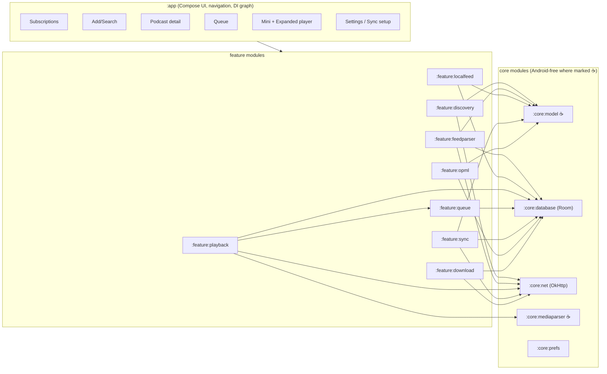
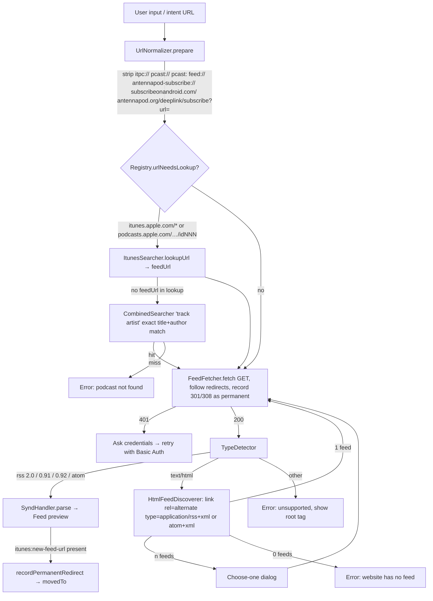

# MiniPod — Architecture

> Companion to [DESIGN.md](DESIGN.md). This document is normative for implementation: module boundaries, source-adapter interfaces, database schema, the `minipod-sync-v1.json` schema, the merge algorithm and the sync trigger policy.
> AntennaPod class names cited below refer to the upstream repo and are documented in [docs/ANTENNAPOD_SOURCES.md](docs/ANTENNAPOD_SOURCES.md).

---

## 1. Tech stack

### 1.1 Recommended: Android-native Kotlin

| Concern | Choice | Reason |
|---|---|---|
| Language / UI | Kotlin 2.x, Jetpack Compose, Material 3 | Bottom sheet, drag-reorder (`LazyColumn` + `reorderable`), swipe-to-dismiss are first-class. |
| Playback | **Media3** `ExoPlayer` + `MediaSessionService` | Byte-range seeking of streams, playback speed 0.5–3.0 (`PlaybackParameters`), audio-focus handling, Bluetooth/Auto/notification for free; video via `PlayerSurface`. |
| Persistence | Room (SQLite) + DataStore (prefs) | Flow-based observation drives every screen. |
| Networking | OkHttp 5 + `kotlinx.serialization` | Interceptors for User-Agent, Basic-Auth, redirect capture; identical to AntennaPod's `AntennapodHttpClient` approach. |
| XML parsing | `XmlPullParser` (SAX-like streaming) + Jsoup for HTML | Same parser family as AntennaPod → straightforward port of `SyndHandler` and `FeedDiscoverer`. |
| Media tag parsing | Own readers for ID3v2 `CHAP`/`CTOC`, Vorbis comments, MP4 `chpl`/`chap` | Port of AntennaPod `parser/media`. |
| Images | Coil | Disk cache for covers & chapter images. |
| Background work | `WorkManager` (feed refresh, sync pull) + in-process `SyncScheduler` | Battery-compliant periodic work; immediate work when the app is alive. |
| Cloud auth | Credential Manager + Google Identity `AuthorizationClient` (Drive); AppAuth is **not** required | Only the Drive provider needs OAuth. |
| DI | Hilt | Keeps `CloudFileProvider`/`PodcastSearcher` sets pluggable via multibindings. |
| Min SDK | 26 | Foreground media service + SAF persistable permissions are stable; covers > 95 % of devices. |

### 1.2 Alternatives considered

| Option | Verdict |
|---|---|
| **Flutter** (`just_audio` + `audio_service`, `drift`, `file_picker`/`saf` plugins) | Viable; cross-platform iOS bonus. Costs: SAF persistable-URI handling and ID3 chapter parsing live in platform channels, Media3 feature parity is weaker (byte-range cache, video). Recommended only if iOS is a hard requirement. |
| **Kotlin Multiplatform** with shared `:core:*` and `:feature:sync` | Attractive middle ground: feed parser, merge algorithm and providers are pure Kotlin + Ktor. UI stays Compose on Android. Chosen module layout keeps JVM-pure modules free of Android imports to leave this door open. |
| React Native / Capacitor | Not recommended: background audio & SAF story is weakest. |

## 2. Module architecture



Dependency rules (enforced by Gradle `api`/`implementation` and a Konsist test):

1. `feature:*` never depend on each other except `playback → queue` (auto-advance) and `sync → *` only through the `SyncableRepository` interfaces in `:core:database`.
2. `:core:model`, `:core:mediaparser` and the merge algorithm in `:feature:sync:merge` contain no `android.*` imports (unit-testable on JVM, KMP-ready).
3. Every network call goes through the one `OkHttpClient` from `:core:net`.

### 2.1 Package map

```
app/                        ui.subscriptions, ui.add, ui.detail, ui.queue, ui.player, ui.settings, navigation, MainActivity, IntentRouter
feature/discovery/          PodcastSearcher, PodcastSearcherRegistry, CombinedSearcher, ItunesSearcher, ItunesTopListLoader,
                            PodcastIndexSearcher, FyydSearcher, GpodderSearcher, FeedUrlResolver, UrlNormalizer
feature/feedparser/         FeedFetcher, TypeDetector, SyndHandler, HandlerState, namespace/{Rss20,Atom,Itunes,PodcastIndex,
                            Content,Media,SimpleChapters,DublinCore}, HtmlFeedDiscoverer, PodcastIndexChapterParser
feature/localfeed/          LocalFeedUpdater, FastDocumentFile
feature/opml/               OpmlReader, OpmlWriter
feature/download/           EpisodeDownloader (OkHttp + WorkManager), DownloadStore
feature/playback/           PlaybackService (MediaSessionService), PlayerController, ProgressRecorder, SleepTimer,
                            ChapterLoader, AutoAdvancePolicy
feature/queue/              QueueRepository, QueuePositionKeys
feature/sync/               SyncEngine, SyncScheduler, SyncDocument (schema), Merge (algorithm), Hlc,
                            provider/{CloudFileProvider, SafFileProvider, GoogleDriveAppDataProvider,
                                      GoogleDriveFileProvider, WebDavProvider, GitHubGistProvider}
core/model/                 Feed, Episode, Chapter, Progress, QueueEntry, PlaybackState, SearchResult, FeedCredentials
core/database/              MiniPodDb, dao/*, entities/*, repositories (FeedRepository, EpisodeRepository,
                            ProgressRepository, QueueRepository impl), SyncableRepository
core/net/                   HttpClientFactory, UserAgentInterceptor, BasicAuthInterceptor, RedirectRecorder, CredentialStore
core/mediaparser/           id3/ChapterReader, vorbis/VorbisCommentChapterReader, mp4/M4AChapterReader, CountingInputStream
```

## 3. Discovery layer

### 3.1 Interfaces

```kotlin
// :feature:discovery
data class SearchResult(
    val title: String,
    val author: String?,
    val imageUrl: String?,
    val feedUrl: String,              // may be an iTunes lookup URL until resolved
    val source: SourceId,
)

enum class SourceId { APPLE, PODCAST_INDEX, FYYD, GPODDER, COMBINED }

interface PodcastSearcher {
    val id: SourceId
    val displayName: String
    /** Weight used by CombinedSearcher; 0 = excluded from federated search (still usable alone). */
    val combinedWeight: Float
    suspend fun search(query: String): List<SearchResult>
    /** True if [url] must be translated before fetching (e.g. podcasts.apple.com page → feed URL). */
    fun urlNeedsLookup(url: String): Boolean = false
    suspend fun lookupUrl(url: String): String = url
}

interface TopListLoader {
    suspend fun topPodcasts(countryIso2: String, limit: Int = 25): List<SearchResult>
}

class PodcastSearcherRegistry @Inject constructor(searchers: Set<@JvmSuppressWildcards PodcastSearcher>) {
    val all: List<PodcastSearcher>          // ordered: COMBINED, APPLE, PODCAST_INDEX, FYYD, GPODDER
    fun byId(id: SourceId): PodcastSearcher
    fun urlNeedsLookup(url: String) = all.any { it.id != SourceId.COMBINED && it.urlNeedsLookup(url) }
    suspend fun lookupUrl(url: String): String =
        all.firstOrNull { it.id != SourceId.COMBINED && it.urlNeedsLookup(url) }?.lookupUrl(url) ?: url
}
```

### 3.2 Adapters (parity with AntennaPod, verified against upstream source)

| Adapter | Endpoint(s) | Auth | Mapping | Weight |
|---|---|---|---|---|
| `ItunesSearcher` | `GET https://itunes.apple.com/search?media=podcast&term={q}` ; `urlNeedsLookup(url) = url.contains("itunes.apple.com") || url.matches(".*/podcasts\.apple\.com/.*/podcast/.*/id(\d+).*")` (upstream rule — covers `/lookup?id=` URLs emitted by the top list, legacy `itunes.apple.com/…/idNNN` and `podcasts.apple.com` pages); lookup `GET https://itunes.apple.com/lookup?id={id}` → `results[0].feedUrl`. If `results[0]` has no `feedUrl` → `FeedUrlNotFoundException(artistName, trackName)` → **search fallback** (upstream `OnlineFeedViewActivity.tryToRetrieveFeedUrlBySearch`): `CombinedSearcher.search("$trackName $artistName")`, pick the first result whose `title` and `author` match case-insensitively; else "podcast not found". | none | `results[]` → `collectionName`, `artistName`, `artworkUrl100`, `feedUrl` (skip entries lacking `feedUrl`) | 1.0 |
| `ItunesTopListLoader` | `GET https://itunes.apple.com/{cc}/rss/toppodcasts/limit=25/explicit=true/json`; `cc` from the picker; falls back to `US` **only** when the country is unset (`"99"`); an explicitly chosen country with no data surfaces "iTunes has no data for this country" | none | `feed.entry[]` → `im:name.label`, `im:artist.label`, largest `im:image`, `feedUrl = https://itunes.apple.com/lookup?id={id.attributes.im:id}` (resolved through `ItunesSearcher.lookupUrl` on tap) | — |
| `PodcastIndexSearcher` | `GET https://api.podcastindex.org/api/1.0/search/byterm?q={q}` | `X-Auth-Key: KEY`, `X-Auth-Date: epochSeconds`, `Authorization: sha1Hex(KEY + SECRET + epochSeconds)`, `User-Agent` | `feeds[]` → `title`, `author`, `image`, `url` (skip entries lacking `url`) | 1.0 |
| `FyydSearcher` | `GET https://api.fyyd.de/0.2/search/podcast?title={q}&count=10` | none | `data[]` → `title`, `author`, `thumbImageURL`, `xmlURL` | 0.0 (upstream default; still selectable as a chip) |
| `GpodderSearcher` | `GET https://gpodder.net/search.json?q={q}` ; top list `GET https://gpodder.net/toplist/{n}.json` | none | `[]` → `title`, `author`, `logo_url`/`scaled_logo_url`, `url` | 0.0 (public instance unreliable; AntennaPod removed its searcher in #7047 — kept here because the product brief asks for it) |
| `CombinedSearcher` | fan-out to every searcher with `combinedWeight > 0` | — | see §3.3 | — |

Key handling: `PODCASTINDEX_API_KEY/SECRET` are read from `local.properties` when present and otherwise fall back to the **same public default key pair AntennaPod ships in `net/discovery/build.gradle`** (`XTMMQGA2YZ4WJUBYY4HK` / `XAaAhk4^2YBsTE33vdbwbZNj82ZRLABDDqFdKe7x`), so a clean checkout has working PodcastIndex search and P4 ("no configuration before value") holds. Forks are expected to register their own key.

### 3.3 `CombinedSearcher` algorithm (port of upstream `weightSearchResults`)

```
results[i] = searcher_i.search(q)   // in parallel, each with 10 s timeout; failures → empty list
ranking = map<feedUrl, Float>; byUrl = map<feedUrl, SearchResult>
for i, list in results:                       // only searchers with weight > 0
    for pos, r in list.withIndex():
        byUrl[r.feedUrl] = r
        ranking[r.feedUrl] = ((ranking[r.feedUrl] ?: 0f) + 1f / (pos + 1)) * weight_i   // exact upstream formula
return byUrl.values sorted by ranking desc
```

De-duplication key is `UrlNormalizer.feedKey(feedUrl)` (§3.5) rather than upstream's raw `feedUrl`, so `http://` vs `https://` and trailing-slash duplicates collapse (equivalent to upstream `UrlChecker.urlEquals`, which is also scheme-agnostic). Individual provider failures are logged and treated as empty lists; cancelling the combined search cancels all in-flight provider calls (structured concurrency replaces upstream's `CountDownLatch` + `doOnDispose`).

### 3.4 URL resolve pipeline (`FeedUrlResolver`)



`UrlNormalizer.prepare(url)` is a port of upstream `UrlChecker.prepareUrl` (case-insensitive scheme handling, `http://` prefix when no scheme, relative URL resolution against a base). `HtmlFeedDiscoverer` resolves `href` with `HttpUrl.resolve()` against the page URL (relative paths and query strings survive; upstream's `Uri.buildUpon().path(href)` does not). `TypeDetector` is a port of `TypeGetter`: root `<rss version=2.0|0.91|0.92|absent>` → RSS, root `<feed>` → Atom, anything else → `UnsupportedFeedTypeException(rootTag, htmlTitle?)`. RSS 1.0/RDF is **not** parsed by upstream and is therefore not claimed; MiniPod adds a tiny `rdf:RDF` branch (items under `<item>`, `dc:date`) as a guarded extension — flagged as beyond-parity in the source inventory.

Because `http://` is the default scheme for scheme-less and `feed://`/`itpc://` input (upstream behaviour), the manifest declares `android:usesCleartextTraffic="true"` (as upstream does) so API 28+ does not block such feeds or enclosures; the fetcher still upgrades to `https://` whenever the server redirects (§4.2).

### 3.5 Feed identity: `UrlNormalizer.feedKey()`

`feedKey` must be identical on every device for the same podcast regardless of how the URL was typed or which scheme a directory returned. It mirrors upstream `UrlChecker.urlEquals` (which already treats `http`/`https` as equal) and is defined as:

1. `prepare()` as above; 2. **drop the scheme**; 3. lowercase the host; 4. drop default ports and the fragment; 5. normalise path segments (drop empty segments / trailing slash); 6. keep the query string verbatim (empty ≡ absent); 7. `feedKey = "f_" + sha1Hex(host + "/" + path + "?" + query)`.

`feeds.url` keeps the real, scheme-bearing URL used for fetching. Consequences:

- `feed://example.com/rss` → `http://…` → 301 → `https://…` keeps **one** `feedKey`; only `feeds.url` changes.
- A permanent move to a different host/path (HTTP 301/308, `http→https` hop, or `<itunes:new-feed-url>`) is recorded as `movedTo` on the **original** key. If `feedKey(movedTo)` equals an existing key on the device, the two are aliased: the old key becomes a tombstone and progress/queue rows are re-keyed to the surviving key (progress keys are re-derived since `episodeKey` embeds the `feedKey`; the `identity` field in the sync document makes the re-derivation possible on every device).
- On subscribe, if `feedKey(resolvedUrl)` already exists locally (including as a tombstone), the existing row is revived with a fresh `updatedAt` rather than creating a duplicate.

## 4. Feed ingestion layer

### 4.1 Parser

```kotlin
interface FeedParser {
    /** Streams [source]; returns a [ParsedFeed] with episodes, or throws UnsupportedFeedTypeException / XmlPullParserException. */
    suspend fun parse(source: Source, baseUrl: String): ParsedFeed
}

abstract class Namespace {
    abstract fun handleElementStart(localName: String, state: HandlerState, attrs: Attributes): SyndElement
    abstract fun handleElementEnd(localName: String, state: HandlerState)
}
```

Namespace handlers (1:1 with upstream, URIs verified):

| Handler | URI(s) | Elements of interest |
|---|---|---|
| `Rss20` | (default) | `channel/title,link,description,language,image/url,item/title,link,description,pubDate,guid,enclosure(url,type,length)` |
| `Atom` | `http://www.w3.org/2005/Atom` | `feed/title,subtitle,link[rel=alternate|enclosure|payment|next],logo,icon,entry/id,title,updated,published,content,summary,author` — `link[rel=next]` → `ParsedFeed.nextPageUrl` (RFC 5005 paged feeds, as upstream `setNextPageLink`) |
| `Itunes` | `http://www.itunes.com/dtds/podcast-1.0.dtd` and legacy `http://www.itunes.com/DTDs/Podcast-1.0.dtd` | `author,image[href],duration,subtitle,summary,title,new-feed-url` — `new-feed-url` → `ParsedFeed.redirectUrl` → `recordPermanentRedirect` (§3.5) |
| `PodcastIndex` | `https://podcastindex.org/namespace/1.0` and `https://github.com/Podcastindex-org/podcast-namespace/blob/main/docs/1.0.md` | `podcast:chapters[url,type]`, `podcast:transcript[url,type]`, `podcast:funding[url]`, `podcast:socialInteract[uri]` |
| `Content` | `http://purl.org/rss/1.0/modules/content/` | `content:encoded` |
| `Media` | `http://search.yahoo.com/mrss/` | `media:content[url,type,fileSize,duration,medium,isDefault]`, `media:thumbnail[url]`, `media:description` |
| `SimpleChapters` | `http://podlove.org/simple-chapters` (prefix `psc` or `sc`) | `psc:chapters/psc:chapter[start,title,href,image]` |
| `DublinCore` | `http://purl.org/dc/elements/1.1/` | `dc:date` (fallback pubDate) |

Episode identity (ported rule): `guid` → else enclosure URL → else `title + "|" + pubDateEpochMs` (epoch millis, so the key is timezone-independent). See §7.2 for the sync key derived from it.

Paged feeds: when `nextPageUrl` is present the podcast detail list shows a *Load older episodes* footer that fetches and parses the next page into the same feed (upstream behaviour); background refresh only ever fetches the first page.

### 4.2 HTTP behaviour (`:core:net`)

- `UserAgentInterceptor` (`MiniPod/<version> (+https://…)`); `BasicAuthInterceptor` (port of upstream `BasicAuthorizationInterceptor`): on `401`, takes credentials from the URL `userInfo` first, then from `CredentialStore` for the feed; retries with `ISO-8859-1` Base64, then with `UTF-8` (upstream order, via `HttpCredentialEncoder`); re-injects `Authorization` after cross-host/scheme redirects where OkHttp drops it; a persisting 401 surfaces the credential prompt.
- `RedirectRecorder` (port of upstream `RedirectChecker`): inspects `priorResponse()` chain; a 301/308 hop — or any `http://` → identical `https://` hop — marks the final URL as permanent → `FeedRepository.recordPermanentRedirect(feedKey, newUrl)`.
- Conditional feed refresh with `If-None-Match`/`If-Modified-Since` (`feeds.etag`, `feeds.last_modified`).
- Enclosure streaming uses Media3's `OkHttpDataSource` with the same client → Basic Auth and range requests apply to media too.

### 4.3 OPML

- `OpmlReader`: `XmlPullParser`; every `<outline>` with an `xmlUrl` becomes an import candidate (`text`/`title` → title, `type`, `htmlUrl`); nested outlines flattened; shown as a checklist before subscribing.
- `OpmlWriter`: OPML 2.0, `<head><title>MiniPod Subscriptions</title><dateCreated>…`, `<outline text="" title="" type="rss" xmlUrl="" htmlUrl=""/>` per feed. Local-folder feeds are excluded. Exported via `ACTION_CREATE_DOCUMENT`.
- Intents: `ACTION_VIEW` with mime `text/x-opml`, `text/xml`, `application/xml` on `file`/`content`/`http(s)` schemes → OPML import screen.

### 4.4 Local Folder virtual feeds

`LocalFeedUpdater` (port): `ACTION_OPEN_DOCUMENT_TREE` → persist URI → `DocumentsContract` listing (one query per folder, like upstream `FastDocumentFile`). Media files (mime `audio/*`, `video/*`, or by extension) become episodes: identity = **file name** (upstream rule; stable across re-scans and renames of the parent), enclosure = document URI; title via ID3/Vorbis/MP4 tag readers (`:core:mediaparser`) falling back to the file name without extension; `pubDate` = tag date else `lastModified`; embedded picture as episode image. Cover = `folder.jpg|Folder.jpg|folder.png|Folder.png`, else first `image/jpeg|png` in the folder, else a generated placeholder. `feeds.kind = LOCAL`, `feeds.url = "local-folder:" + treeUri` (upstream prefix, so OPML/intent code can recognise it), never synced, never downloaded (files are already local).

## 5. Playback layer

```kotlin
interface PlayerController {               // used by UI; implemented over MediaController (Media3)
    val state: StateFlow<PlaybackState>      // episodeKey, isPlaying, positionMs, durationMs, speed, chapters, sleepTimer
    fun play(episodeKey: String)             // enqueue-at-head if not queued, then play
    fun togglePlayPause()
    fun seekTo(ms: Long); fun skip(deltaMs: Long)   // UI passes -10_000 / +30_000
    fun setSpeed(speed: Float)               // clamped 0.5f..3.0f
    fun setSleepTimer(mode: SleepTimer)      // Off / Minutes(n) / EndOfEpisode / EndOfChapter
}
```

- `PlaybackService : MediaSessionService` owns `ExoPlayer`; `MediaItem` = episode (`mediaId = episodeKey`, downloaded file URI when present else enclosure URL). Only the current item is loaded; auto-advance is driven by `AutoAdvancePolicy` reading the queue, so queue edits never fight ExoPlayer's internal playlist.
- `ProgressRecorder` subscribes to the player: writes `progress` every 5 s while playing, and on pause/stop/seek/`STATE_ENDED`/service destroy. Completion rule: `STATE_ENDED` **or** (`duration > 0` i.e. not `C.TIME_UNSET`, **and** `position ≥ duration − 1000 ms`) at pause/stop → `PLAYED`, `positionMs = 0`, `playedAt = now`, queue tombstone, download deleted if "Delete when played". Feeds without a known duration can only complete through `STATE_ENDED`. Pause/stop/complete also ask `SyncScheduler` for a push (§9.2) from inside the service, since most pauses come from earbuds/lockscreen while no Activity is alive.
- `ChapterLoader` (port of upstream `ChapterUtils` + `ChapterMerger`) gathers up to three lists and merges them rather than picking one:
  1. feed-declared: `psc:chapters` stored at parse time;
  2. embedded: content sniffed by magic bytes (`ID3`, `OggS`, `fLaC`, `ftyp`) → ID3v2 (`CHAP`/`CTOC`, with `APIC` sub-frames exposed as `id3apic://<episodeKey>/<offset>/<length>` URIs served by a Coil `Fetcher` that range-reads the slice), Vorbis comments (`CHAPTER001`, `CHAPTER001NAME`, `CHAPTER001URL`; key parsed as `substring(7)` and the `HH:MM:SS.mmm` value converted to ms without integer truncation), MP4 (`moov.udta.chpl` / Nero `chap`), read via range requests on the stream or from the local file;
  3. external: `podcast:chapters` JSON (`PodcastIndexChapterParser`: `chapters[].startTime` parsed as `Double` seconds → ms, `title`, `url`, `img`).

  `ChapterMerger.merge(a, b)`: empty → other; different sizes → the longer list; equal sizes with every `|startA−startB| ≤ 1000 ms` → positional merge filling missing title/link/image from the other list; otherwise the list with the higher quality score `Σ(hasTitle + hasLink + hasImage)`. Applied as `merge(merge(feed, embedded), external)`. Each list is **sorted by `startMs`** before merging (ID3 `CHAP` frames are often out of order); a list is valid when it is non-empty and every start ≥ 0 (single-chapter lists are allowed, as upstream). Empty titles are enumerated ("Chapter 3"). Results are cached in `chapters`.
- `SleepTimer`: countdown in the service; fades volume over the last 60 s; `EndOfChapter` resolves from current chapter list.

## 6. Database schema (Room, `minipod.db`, schema v1)

```sql
CREATE TABLE feeds (
  id              INTEGER PRIMARY KEY AUTOINCREMENT,
  feed_key        TEXT    NOT NULL UNIQUE,           -- "f_" + sha1(scheme-less canonical url) ; local: "l_" + sha1(tree uri)
  kind            TEXT    NOT NULL CHECK (kind IN ('RSS','LOCAL')),
  subscribed      INTEGER NOT NULL DEFAULT 0,        -- 0 = stub (preview / queued-but-not-subscribed / synced placeholder), 1 = subscribed
  url             TEXT    NOT NULL,                  -- current (post-redirect) URL or "local-folder:" + tree URI
  title           TEXT,
  author          TEXT,
  description     TEXT,
  link            TEXT,
  image_url       TEXT,
  language        TEXT,
  funding_url     TEXT,
  has_credentials INTEGER NOT NULL DEFAULT 0,        -- creds themselves live in CredentialStore (EncryptedSharedPreferences)
  etag            TEXT,
  last_modified   TEXT,
  next_page_url   TEXT,                              -- RFC 5005 paged feeds
  last_refreshed_at INTEGER,
  last_episode_at INTEGER,                           -- for grid ordering
  added_at        INTEGER NOT NULL,                  -- HLC ms
  updated_at      INTEGER NOT NULL,                  -- HLC ms; bumps on subscribe/unsubscribe/URL move
  deleted_at      INTEGER,                           -- tombstone for a *subscription*; row kept until GC
  sync_dirty      INTEGER NOT NULL DEFAULT 1
);

CREATE TABLE episodes (
  id              INTEGER PRIMARY KEY AUTOINCREMENT,
  feed_id         INTEGER NOT NULL REFERENCES feeds(id) ON DELETE CASCADE,
  episode_key     TEXT    NOT NULL UNIQUE,           -- "e_" + sha1(feed_key + "\n" + identity), see §7.2
  identity        TEXT    NOT NULL,                  -- guid | enclosure url | title+pubDateEpochMs
  is_stub         INTEGER NOT NULL DEFAULT 0,        -- 1 = materialised from a sync queue stub; replaced on next feed parse
  title           TEXT    NOT NULL,
  description     TEXT,                              -- content:encoded > description > itunes:summary
  link            TEXT,
  image_url       TEXT,
  pub_date        INTEGER,
  duration_ms     INTEGER,
  enclosure_url   TEXT,
  enclosure_mime  TEXT,
  enclosure_size  INTEGER,
  media_type      TEXT CHECK (media_type IN ('AUDIO','VIDEO','UNKNOWN')),
  chapters_url    TEXT, chapters_type TEXT,          -- podcast:chapters
  transcript_url  TEXT, transcript_type TEXT,        -- podcast:transcript (stored, not rendered in v1)
  download_path   TEXT,                              -- non-null when downloaded
  download_state  TEXT NOT NULL DEFAULT 'NONE' CHECK (download_state IN ('NONE','QUEUED','RUNNING','DONE','FAILED'))
);
CREATE INDEX idx_episodes_feed_pub ON episodes(feed_id, pub_date DESC);

CREATE TABLE progress (
  episode_key     TEXT PRIMARY KEY,                  -- may exist before the episode row (received via sync)
  feed_key        TEXT NOT NULL,
  position_ms     INTEGER NOT NULL DEFAULT 0,
  duration_ms     INTEGER,
  state           TEXT NOT NULL CHECK (state IN ('NEW','IN_PROGRESS','PLAYED')),
  played_at       INTEGER,
  updated_at      INTEGER NOT NULL,                  -- HLC ms
  device_id       TEXT NOT NULL,
  sync_dirty      INTEGER NOT NULL DEFAULT 1
);
CREATE INDEX idx_progress_feed ON progress(feed_key);

CREATE TABLE queue (
  episode_key     TEXT PRIMARY KEY,
  feed_key        TEXT NOT NULL,
  pos             TEXT NOT NULL,                     -- fractional-index string key, see §7.4
  added_at        INTEGER NOT NULL,
  updated_at      INTEGER NOT NULL,                  -- HLC ms; bumps on move/remove/re-add
  removed         INTEGER NOT NULL DEFAULT 0,        -- tombstone
  sync_dirty      INTEGER NOT NULL DEFAULT 1
);
CREATE INDEX idx_queue_order ON queue(removed, pos);

CREATE TABLE chapters (
  episode_id      INTEGER NOT NULL REFERENCES episodes(id) ON DELETE CASCADE,
  start_ms        INTEGER NOT NULL,
  title           TEXT, link TEXT, image_url TEXT,
  source          TEXT NOT NULL,                     -- 'PI_JSON','PSC','ID3','VORBIS','MP4'
  PRIMARY KEY (episode_id, start_ms)
);

CREATE TABLE sync_state (                            -- single row
  id              INTEGER PRIMARY KEY CHECK (id = 1),
  provider        TEXT,                              -- 'SAF','DRIVE_APPDATA','DRIVE_FILE','WEBDAV','GIST', NULL = off
  provider_config TEXT,                              -- JSON (URIs, gist id, webdav url/user); secrets in CredentialStore
  device_id       TEXT NOT NULL,
  device_name     TEXT NOT NULL,
  remote_etag     TEXT,                              -- ETag / Drive md5Checksum / SAF lastModified+size
  remote_file_id  TEXT,                              -- Drive fileId / Gist id once resolved
  remote_rev      INTEGER NOT NULL DEFAULT 0,
  floor_subscriptions INTEGER NOT NULL DEFAULT 0,    -- last seen remote tombstone floors (§7.7)
  floor_queue     INTEGER NOT NULL DEFAULT 0,
  floor_progress  INTEGER NOT NULL DEFAULT 0,
  hlc_last        INTEGER NOT NULL DEFAULT 0,        -- hybrid logical clock state
  last_pull_at    INTEGER, last_push_at INTEGER,
  last_error      TEXT,
  backoff_until   INTEGER
);
```

Lifecycle rules the schema relies on:

- **Feed stubs** (`subscribed = 0`) exist for (a) a feed being previewed, (b) a feed whose episode is queued/playing without a subscription ("tap ▶ streams without subscribing"), (c) a subscription received via sync whose RSS has not been fetched yet. Stubs are hidden from the Subscriptions grid; they are purged when no episode of theirs is queued, playing, downloaded or in progress and the preview screen is closed.
- **Unsubscribing is a soft delete** (`deleted_at`, `subscribed = 0`), so SQL `ON DELETE CASCADE` does not fire. `FeedRepository.unsubscribe()` explicitly: deletes downloads, deletes `episodes` rows of the feed that are not queued/playing, tombstones (`removed = 1`, fresh `updated_at`) every active `queue` row with that `feed_key`, and keeps `progress` rows (harmless; allow re-subscribe). Episodes are never deleted on feed refresh, so an episode that aged off a 50-item feed stays playable on the device that queued it.
- Views used by the UI: `v_episode_rows` (episode ⨝ progress ⨝ queue-membership) and `v_queue` = `queue WHERE removed = 0 ORDER BY pos, added_at, episode_key` **LEFT JOIN** `episodes` LEFT JOIN `progress`. A queue row always has an `episodes` row because `SyncEngine.apply` materialises a stub episode (§7.6), but the LEFT JOIN guarantees a synced queue is never silently hidden by a missing join partner.

## 7. Sync document: `minipod-sync-v1.json`

### 7.1 Schema

```jsonc
{
  "schema": "minipod-sync",
  "schemaVersion": 1,
  "rev": 418,                               // stamped by the writer at upload time: max(local.knownRev, remote.rev) + 1 (never touched by merge)
  "writtenAt": 1761823456789,               // wall clock of the writer (informational, never used for ordering)
  "writtenBy": "d_7f3a…",                   // deviceId of the writer
  "hlcMax": 1761823456789,                  // largest HLC timestamp contained in this document (readers fast-forward their clock, capped)

  "devices": {
    "d_7f3a…": { "name": "Pixel 8",       "app": "minipod/1.0.0", "lastSeenAt": 1761823456789 },
    "d_91c0…": { "name": "Pixel Tablet",  "app": "minipod/1.0.0", "lastSeenAt": 1761810000000 }
  },

  "subscriptions": {
    "floor": 1755000000000,                  // tombstone floor: every tombstone with updatedAt <= floor has been GC'd (§7.7)
    "items": {                               // key = feedKey
      "f_3e9a…": {
        "url": "https://example.com/feed.xml", // fetch URL at subscribe time (scheme-bearing)
        "movedTo": null,                       // set after a 301/308, http→https hop or <itunes:new-feed-url>; other devices follow
        "title": "Example Show",               // display hint only
        "imageUrl": "https://example.com/cover.jpg",
        "hasCredentials": true,                // other devices prompt once; credentials are NEVER written to this file
        "updatedAt": 1761820000000,            // HLC: last subscribe/unsubscribe/move
        "deleted": false,
        "deviceId": "d_7f3a…"
      },
      "f_aa10…": { "url": "https://…", "title": "Old Show", "updatedAt": 1761700000000, "deleted": true, "deviceId": "d_91c0…" }
    }
  },

  "queue": {
    "floor": 1759000000000,
    "items": {                               // key = episodeKey ; order = sort by (pos, addedAt, episodeKey)
      "e_55d1…": {
        "feedKey": "f_3e9a…", "pos": "a0", "addedAt": 1761800000000, "updatedAt": 1761800000000,
        "removed": false, "deviceId": "d_7f3a…",
        "stub": {                            // present iff removed == false: enough to render + stream on a device that has not fetched the feed
          "identity": "https://example.com/ep55.mp3",
          "title": "Episode 55", "feedTitle": "Example Show", "feedUrl": "https://example.com/feed.xml",
          "enclosureUrl": "https://example.com/ep55.mp3", "enclosureMime": "audio/mpeg",
          "durationMs": 2890000, "imageUrl": "https://example.com/55.jpg", "pubDate": 1761700000000
        }
      },
      "e_9b2c…": { "feedKey": "f_3e9a…", "pos": "a0V", "addedAt": 1761801000000, "updatedAt": 1761822000000, "removed": false, "deviceId": "d_91c0…", "stub": { "…": "…" } },
      "e_01ff…": { "feedKey": "f_3e9a…", "pos": "Zz",  "addedAt": 1761790000000, "updatedAt": 1761823000000, "removed": true,  "deviceId": "d_7f3a…" }
    }
  },

  "progress": {
    "floor": 1740000000000,                  // eviction floor: entries with updatedAt <= floor may have been evicted (§7.7)
    "items": {                               // key = episodeKey
      "e_55d1…": {
        "feedKey": "f_3e9a…",
        "identity": "https://example.com/ep55.mp3",   // guid|enclosure|title+date, lets a device that has not fetched the feed yet match later
        "positionMs": 1391000,
        "durationMs": 2890000,
        "state": "IN_PROGRESS",                // NEW | IN_PROGRESS | PLAYED
        "playedAt": null,
        "updatedAt": 1761823450000,            // HLC
        "deviceId": "d_7f3a…"
      }
    }
  }
}
```

Hard limits: subscriptions ≤ 5 000, queue entries ≤ 1 000 (incl. tombstones), progress ≤ 50 000 entries (oldest `PLAYED` evicted first, raising `progress.floor`) → typical file 200 KB–3 MB, gzip-friendly. WebDAV stores it with `Content-Encoding: gzip`; SAF and Drive store raw JSON so other tools can read it; Gist switches to gzip+base64 above 800 KB (§8.2).

Secrets are never part of the document: `hasCredentials` only tells the other device to prompt once. (A plaintext credential field was considered and rejected — secret Gists are unlisted, not private.)

### 7.2 Identity keys

```
feedKey    = "f_" + sha1Hex(schemeLessCanonical(feedUrl))              // RSS/Atom feeds, §3.5
           = "l_" + sha1Hex(treeUri)                                   // local folders (never leaves the device)
identity   = item.guid?.trim().ifEmpty(null) ?: enclosureUrl ?: (title + "|" + pubDateEpochMs)
episodeKey = "e_" + sha1Hex(feedKey + "\n" + identity)
deviceId   = "d_" + 16 random bytes hex, generated once per install (not ANDROID_ID)
```

Because `episodeKey` is a pure function of feed + item, two devices derive the same key independently; no ID allocation protocol is needed. A GUID change by the publisher produces a new key (same behaviour as AntennaPod, where it also forks the item); the `identity` field allows a best-effort fallback match on enclosure URL when a device encounters an unknown key. When feeds are aliased after a move (§3.5), `episodeKey`s are re-derived from `identity` under the surviving `feedKey`.

### 7.3 Clocks: hybrid logical clock (HLC)

All `updatedAt` values are HLC milliseconds. The clock is only ever advanced by **local** operations; `merge()` never alters a timestamp.

```
// local write
fun now(): Long { val wall = System.currentTimeMillis(); hlc = max(wall, hlc + 1); return hlc }

// after reading a remote document (in SyncEngine, not in merge)
fun observe(remoteHlcMax: Long) { hlc = max(hlc, min(remoteHlcMax, System.currentTimeMillis() + 5 * 60_000)) }

// stamping a local mutation of entity e (subscribe, queue move, progress tick, …)
e.updatedAt = max(hlc.now(), (previousLocalRecordOf(e)?.updatedAt ?: 0) + 1)
```

Effects:

- A device whose wall clock is behind still produces timestamps after anything it has already merged, so "I edited after I saw your edit" always wins.
- A device whose wall clock is far ahead can push the *global* HLC forward by at most 5 minutes per observation (the cap in `observe`). Its own records keep their large timestamps — they are not clamped, so merge stays pure and convergent — but any later **local edit of the same entity** on any device uses `previous.updatedAt + 1`, so a causal edit always beats the skewed record. The damage of a bad clock is therefore limited to "that device's last write of an entity wins until someone edits it again", never to a loop or divergence.

### 7.4 Queue ordering: fractional index keys

`pos` is a base-62 string key (Figma-style fractional indexing, as in the `fractional-indexing` reference algorithm): inserting between `a0` and `a1` yields `a0V`; appending after the last key yields a key that sorts after it; prepending before the first yields one that sorts before it. Properties:

- A move changes **only the moved entry** (`pos`, `updatedAt`), so concurrent moves of different entries merge cleanly.
- Ties (two devices generate the same `pos` for different entries) are broken by `addedAt`, then `episodeKey` — total order, deterministic on every device.
- Keys are rebalanced (rewritten compactly) only when the queue is empty or when a key exceeds 64 chars — a local-only operation that bumps `updatedAt` of every rewritten entry, so it is rare by design.

### 7.5 Merge algorithm (pure, deterministic, commutative, idempotent)

`merge` is a pure function of two documents. It does not read the clock, does not stamp `rev`/`writtenAt`/`writtenBy`, and never modifies a timestamp; those are the engine's job (§9.1).

```
merge(a: Doc, b: Doc) -> Doc:
    out.devices = union by deviceId, keep max lastSeenAt and the name from that record

    for map in [subscriptions, queue, progress]:
        floor = max(a[map].floor, b[map].floor)
        out[map].floor = floor
        for key in keys(a[map].items ∪ b[map].items):
            x = a[map].items[key]; y = b[map].items[key]
            // floor rule: an entry known to only one side and older than the other side's floor
            // was tombstoned-and-GC'd (or evicted) there → it is dropped, not resurrected
            if x == null and y.updatedAt <= a[map].floor: continue
            if y == null and x.updatedAt <= b[map].floor: continue
            out[map].items[key] = pick(map, x, y)

    out.hlcMax = max over all updatedAt in out
    return out

pick(map, x, y):
    if x == null return y ; if y == null return x
    if x.updatedAt != y.updatedAt return the newer
    // identical HLC from two devices (same-device ties are impossible, see §7.3):
    subscriptions: prefer deleted == false, then smaller deviceId
                   // then: carry movedTo from either record if the winner lacks one
    queue:         prefer removed == false, then smaller deviceId
    progress:      prefer higher rank(state)  (PLAYED > IN_PROGRESS > NEW),
                   then larger positionMs, then smaller deviceId
```

Invariants (unit-tested with property-based tests over random edit histories on N devices with skewed clocks, lost uploads and reordered deliveries):

1. `merge(a, b) == merge(b, a)`; `merge(a, a) == a`; `merge(merge(a, b), c) == merge(a, merge(b, c))` — the document is a state-based CRDT (LWW-register map with tombstones and a monotone floor), so lost or out-of-order uploads can only delay convergence, never corrupt it.
2. A deleted subscription is never resurrected by a device that did not *re-subscribe* after the deletion: either the tombstone is still present and newer than the stale record, or the stale record is older than the floor and dropped.
3. Progress for an episode moves backwards only when a strictly newer write says so (e.g. the user deliberately seeked back on another device).
4. `merge(local, remote) == remote` whenever local has no dirty rows and has already applied `remote` — this is what lets the engine skip uploads (§9.1) and is what rules out ping-pong between idle devices.

### 7.6 Local preparation and application (`SyncEngine`)

**Before merge** (`prepareLocalDoc`):

- Build the local document from Room: all non-GC'd rows, each with its `updatedAt`; `floor`s from `sync_state`.
- Any **dirty** local row whose `updatedAt <= remote[map].floor` (possible after a very long offline period) is a genuinely new local intent that the remote has never seen → re-stamp it with `hlc.now()` so the floor rule cannot drop it.

**After merge** (`apply(merged)`, one Room transaction), for every entity whose winner differs from the local row:

| Entity | Local effect |
|---|---|
| Subscription, `deleted=false`, unknown locally | Insert `feeds` row (`subscribed=1`, `title`/`imageUrl` hints, `url`), schedule a feed refresh; if `hasCredentials` and no local creds → badge "needs sign-in" on the cover. |
| Subscription, `deleted=true`, present locally | Run the soft-delete routine from §6 (downloads, non-queued episodes, queue tombstones), keep `progress`. |
| Subscription `movedTo` | Update `feeds.url`; alias to an existing key if `feedKey(movedTo)` already exists (§3.5). |
| Queue entry, `removed=false`, episode unknown locally | Ensure a `feeds` stub exists for `feedKey` (`subscribed=0` unless subscribed), insert an `episodes` row from `stub` with `is_stub=1`, then upsert `queue`. The row is playable immediately; the next feed parse replaces the stub. |
| Queue entry, other | Upsert `queue` row; UI reorders via Flow. If the **currently playing** episode is removed remotely, playback continues but the item is not re-added (it was the user's explicit action elsewhere). |
| Local clean (`sync_dirty=0`) row absent from `merged` | It fell under a floor on the other side → delete locally (subscription: soft-delete routine; queue: hard delete; progress: delete). |
| Progress, episode currently loaded in the player | If remote is newer: seek player to `positionMs`, show "Resumed from <device> — Undo" (undo writes a new local record with `previous.updatedAt + 1`, which then wins). If remote `state=PLAYED`: do not stop playback; mark played, remove from queue, suppress auto-advance for this item. |
| Progress, other episodes | Upsert. |

`apply` sets `sync_dirty = 0` for rows whose local value equals the winner, and leaves it `1` where local won — exactly the set that must be pushed. The document that is uploaded is `merged`, serialised after `apply` succeeded.

### 7.7 Tombstone GC and floors

GC runs on the **writer** immediately before serialising an upload (never inside `merge`):

- Subscription tombstones are kept **180 days** after `updatedAt`; queue tombstones **30 days**; progress entries beyond the 50 000 cap are evicted oldest-`PLAYED`-first.
- A tombstone is GC'd only when every device in `devices` has `lastSeenAt > tombstone.updatedAt`, **or** has itself been unseen for > 180 days (then the device record is dropped too).
- Whenever anything is GC'd/evicted from a map, that map's `floor` is raised to `max(floor, max updatedAt of the removed entries)`. Floors are monotone and merge by `max`.

Why the floor is needed: without it, a device that comes back after the tombstone is gone would re-contribute its clean (never-deleted-there) row and resurrect the subscription. With the floor rule in §7.5 that row is older than the floor and is dropped instead; the only thing such a device can legitimately contribute is a dirty row, which §7.6 re-stamps above the floor. A device that syncs at least once per 180 days never hits the floor at all. GC'd local tombstones are purged from Room in the same `apply`.

## 8. Cloud File Provider abstraction

### 8.1 Interface

```kotlin
// :feature:sync.provider
data class RemoteBlob(val bytes: ByteArray, val etag: String?, val lastModified: Long?)

sealed interface ReadResult { object NotModified : ReadResult; object Missing : ReadResult; data class Blob(val blob: RemoteBlob) : ReadResult }

sealed interface WriteResult {
    data class Ok(val newEtag: String?) : WriteResult
    object Conflict : WriteResult            // precondition failed; caller must re-read and re-merge
    data class Failed(val cause: Throwable, val retryable: Boolean) : WriteResult
}

interface CloudFileProvider {
    val id: ProviderId                        // SAF, DRIVE_APPDATA, DRIVE_FILE, WEBDAV, GIST
    val supportsNativeConditionalWrite: Boolean
    val supportsCheapHead: Boolean            // can detect "unchanged" without downloading the body

    suspend fun probe(): ProbeResult          // validates config/credentials; returns remote existence + etag
    suspend fun head(): String?               // current etag/version, or null if missing
    suspend fun read(ifNoneMatch: String?): ReadResult
    /** ifMatch == null → create only if missing. Implementations without native preconditions MUST call head()
     *  and return Conflict BEFORE transferring any bytes when it differs from ifMatch. */
    suspend fun write(bytes: ByteArray, ifMatch: String?): WriteResult
}
```

Conflict detection contract: providers with a native precondition (WebDAV `If-Match`) rely on it; all others perform a **pre-write** `head()` and refuse to upload when the remote changed. A residual race window (another writer between `head()` and the upload) remains for SAF/Drive/Gist; it cannot lose data because every device keeps its own rows and the next cycle re-merges (§7.5 invariant 1) — it can only delay convergence by one cycle.

### 8.2 Implementations

| Provider | Locate | `head` | `read` | `write` | Conflict detection | Setup cost |
|---|---|---|---|---|---|---|
| **`SafFileProvider`** | `content://` URI from `ACTION_CREATE_DOCUMENT` / `ACTION_OPEN_DOCUMENT` (`application/json`), `takePersistableUriPermission(R|W)` | `DocumentsContract` query `COLUMN_LAST_MODIFIED` + `COLUMN_SIZE` → synthetic etag `"$lastModified-$size"` | `openInputStream` | `openFileDescriptor(uri, "rw")` → write via `FileChannel` from offset 0 → `truncate(bytes.size)` → `fsync` (several `DocumentsProvider`s ignore the `t` in `"wt"`, which would leave trailing garbage when the JSON shrinks) | Emulated: pre-write `head()`; `SecurityException` on a revoked grant → `Failed(retryable=false)` → "needs attention" (§9.3) | Zero — no developer credentials. Works with any `DocumentsProvider`: Dropbox, Nextcloud, Syncthing/FolderSync folders, OneDrive, local storage. Google Drive's SAF provider works but caches aggressively and uploads lazily; the UI recommends the native Drive provider for Google Drive. |
| **`GoogleDriveAppDataProvider`** | `files.list?spaces=appDataFolder&q=name='minipod-sync-v1.json'&fields=files(id,md5Checksum,modifiedTime)`; if **more than one** file matches (two devices bootstrapped concurrently) → download all, merge all, write to the lexicographically smallest `fileId`, delete the others; create with `files.create` multipart, `parents:["appDataFolder"]` | `files.get?fields=md5Checksum` → etag = `md5Checksum` (content hash; `version` is an account-wide counter that jumps arbitrarily and is **not** used for equality) | `files.get?alt=media` | `files.update` (media upload) | Emulated: pre-write `head()`; after upload, store the returned `md5Checksum` as the new etag | OAuth client ID (Android type, SHA-1 bound) + scope `https://www.googleapis.com/auth/drive.appdata`; token via Credential Manager + `AuthorizationClient`. The option is **hidden** when Play Services are unavailable or the build has no OAuth client configured (F-Droid/Graphene/custom builds). |
| **`GoogleDriveFileProvider`** | Same API, scope `drive.file`; visible folder `MiniPod/` + file `minipod-sync.json` created by the app (only app-created files are visible under `drive.file`); same duplicate-file resolution | as above | as above | as above | as above | Same OAuth client. User can inspect/delete the file in Drive; useful for debugging and manual backup. |
| **`WebDavProvider`** | Absolute file URL (Nextcloud/ownCloud/Apache/Synology…) | `HEAD` → `ETag` | `GET` with `If-None-Match` → 304/200 | `PUT` with `If-Match: <etag>` (or `If-None-Match: *` when creating) | Native: `412 Precondition Failed` → `Conflict` | URL + username + app-password (Basic/Digest via OkHttp authenticator). |
| **`GitHubGistProvider`** | Gist ID (created via `POST /gists {public:false, files:{"minipod-sync-v1.json":{content}}}`) | `GET /gists/{id}` with `If-None-Match` → `ETag` (304 does not count against the rate limit) | same call; body = `files["minipod-sync-v1.json"].content`; if `truncated == true`, `GET raw_url` **with the same `Authorization` header**. Content starting with `{` is raw JSON; content starting with `H4sI` (base64 of the gzip magic) is base64-decoded and gunzipped | `PATCH /gists/{id}` with `files.content`; raw JSON up to 800 KB, gzip+base64 above (1 MB hard limit per file) | Emulated: pre-write `head()` compares the `ETag` with `ifMatch`; the `ETag` returned by the PATCH response is stored as the new etag | Fine-grained PAT with `gist` scope. Secret gists are unlisted, not private — the setup screen says so. |

Secrets (tokens, WebDAV password, Drive refresh token when not managed by Play Services) live in `CredentialStore` (EncryptedSharedPreferences / Android Keystore), never in Room or the sync file.

## 9. Sync engine & trigger policy

### 9.1 Engine cycle

```mermaid
sequenceDiagram
    participant S as SyncScheduler
    participant E as SyncEngine
    participant P as CloudFileProvider
    participant DB as Room

    S->>E: run(reason)
    E->>DB: load sync_state; local = prepareLocalDoc() (§7.6)
    E->>P: read(ifNoneMatch = remote_etag)
    alt NotModified and no dirty rows
        E-->>S: done (no-op)
    else NotModified
        E->>E: merged = local  (remote content == what we last applied)
    else Blob
        E->>E: hlc.observe(remote.hlcMax); merged = merge(local, remote)
        E->>DB: apply(merged) (transaction)
    else Missing
        E->>E: merged = local
    end
    alt entity maps of merged ≠ entity maps of remote (or remote Missing)
        E->>E: gc(merged); stamp rev = max(remote.rev, known_rev) + 1, writtenAt/By, hlcMax
        E->>P: write(bytes, ifMatch = etag)
        alt Conflict
            E->>P: read()  → merge again → write (max 3 attempts, then backoff)
        end
        E->>DB: clear sync_dirty for pushed rows, store new etag/rev/floors
    else
        E->>DB: clear sync_dirty (local already equals remote), store etag
    end
    E-->>S: result (ok / retry-after)
```

The upload decision compares **entity maps only** (`devices` is excluded, and `rev`/`writtenAt` are stamped afterwards), so a read-only pull never produces an upload and two idle devices cannot ping-pong. `devices.lastSeenAt` is refreshed only when an upload happens anyway for another reason, or at most once per 24 h.

The cycle is serialised by a `Mutex`; a request arriving mid-cycle sets a `rerun` flag rather than starting a second cycle.

### 9.2 Triggers (event-driven, debounced)

| Trigger | Delay | Direction | Notes |
|---|---|---|---|
| Subscribe / unsubscribe / OPML import | 2 s debounce | push (after pull) | Import of 200 feeds results in one upload. |
| Queue add / remove / reorder / clear | 5 s debounce | push | Drag sessions emit one event at drop. |
| Pause, stop, headset disconnect, audio-focus loss (persistent) — raised **by `PlaybackService`** | 2 s debounce | push | The most important progress write; works with no Activity alive. |
| Episode completed | 2 s debounce | push | Carries `PLAYED` + queue tombstone together. |
| Manual mark played/unplayed, seek while paused | 2 s debounce | push | |
| **Playing checkpoint** | every **180 s** while `isPlaying`, only if `positionMs` changed and no other push happened in the window | push | Caps cloud writes at 20/h during continuous playback (local DB still records every 5 s, so a crash loses ≤ 5 s locally and ≤ 3 min on other devices). Keeps the radio out of permanent tail state and avoids thrashing SAF cloud watchers / creating a Gist commit every 30 s. |
| App foreground (`ON_START`), player sheet opened, episode about to start | immediate, throttled to ≥ 20 s since last pull | pull | Ensures resume point is fresh before playback starts (playback is **not** blocked: it starts locally, and a newer remote position triggers the "Resumed from…" seek). |
| App background (`ON_STOP`) | immediate, **only if dirty rows exist** | push | Enqueued as an expedited `OneTimeWorkRequest` so it survives process death. |
| Periodic | `PeriodicWorkRequest` 15 min (WorkManager minimum), network constraint; `UNMETERED` when "Wi-Fi only" | pull+push | Skips body download when `head()`/304 says unchanged. |
| "Sync now" | immediate | pull+push | Bypasses backoff. |
| Provider configured / changed | immediate | pull+push | First sync merges existing remote data rather than overwriting. |

Debouncing rule: all push triggers feed one `MutableSharedFlow<Reason>`; the scheduler applies `debounce(reason.delay)` per class and then `conflate()`s into a single engine run, so a pause followed by a queue edit yields exactly one upload.

WorkManager details: the expedited request uses `setExpedited(OutOfQuotaPolicy.RUN_AS_NON_EXPEDITED_WORK_REQUEST)` and the worker implements `getForegroundInfo()` (mandatory on API 26–30, where expedited work is backed by a foreground service and omitting it throws `IllegalStateException`). While `PlaybackService` is in the foreground the engine runs in-process instead, without WorkManager.

### 9.3 Failure handling

- Network / 5xx / `Failed(retryable=true)`: exponential backoff 1 min → 2 → 4 … → 60 min, stored in `sync_state.backoff_until`; dirty rows accumulate and go in the next successful push (no data is lost because local is authoritative for local edits).
- `401`/`403` / revoked SAF permission (`SecurityException`): mark `last_error`, surface a persistent row in Settings ("Sync needs attention") and a one-time notification; stop automatic attempts until the user re-authorizes.
- Malformed remote document (`schema` mismatch, parse error): do **not** overwrite; keep a copy as `minipod-sync-v1.json.corrupt-<ts>` (providers that can) and surface an error. `schemaVersion` > supported → read-only mode, prompt to update the app.
- Remote missing (deleted by the user): recreate from local on next push.

### 9.4 Battery & quota accounting

| Situation | Cloud calls / hour |
|---|---|
| Idle, app closed | ≤ 4 `head`/304 checks |
| 1 h continuous playback, no pauses | ≤ 20 uploads (180 s checkpoint) |
| 1 h playback with 6 pauses | ≤ 26 |
| Heavy queue curation (20 edits in a minute) | 1 |

Worst case remains far below Drive (20 000 req/100 s/project), GitHub (5 000 req/h authenticated; 304s are free), and any WebDAV server; SAF writes are local file operations with the cloud app handling upload on its own schedule.

## 10. Intent & deep-link routing (`IntentRouter`)

| Intent | Handler |
|---|---|
| `ACTION_VIEW` schemes `itpc`, `pcast`, `feed`, `antennapod-subscribe` | Add screen → `FeedUrlResolver` |
| `ACTION_VIEW` `http(s)` with mime `application/rss+xml`, `application/atom+xml`, `text/xml`, `application/xml` | same |
| `ACTION_VIEW` `https://antennapod.org/deeplink/subscribe?url=…`, `https://www.subscribeonandroid.com/<feed>` | same (parity with upstream handlers; harmless to keep) |
| `ACTION_VIEW` / `ACTION_SEND` with `text/x-opml` or `.opml` `content://`/`file://` | OPML import |
| `ACTION_SEND` `text/plain` | Extract the first `https?://`, `feed://`, `itpc://`, `pcast:` URL embedded in the shared text (share sheets usually send `"Title https://…"`), Add screen with the box pre-filled; if no URL is found, the text becomes a search query |

Manifest: `android:usesCleartextTraffic="true"` (as upstream) so plain-`http` feeds, enclosures and `feed://`/`itpc://` rewrites keep working on API 28+.

## 11. Testing strategy

- **Parser fixtures**: port AntennaPod's `parser/feed` test resources (RSS 2.0, 0.91, Atom, iTunes legacy URI, PSC, Podcasting 2.0, media RSS) + fixtures for HTML discovery and OPML.
- **Discovery adapters**: recorded JSON responses (MockWebServer) for each endpoint; `CombinedSearcher` ranking golden tests.
- **Merge**: JVM property-based tests (kotest) generating random concurrent edit traces on 2–5 simulated devices with skewed clocks and random partition/upload loss; assert convergence + invariants §7.5.
- **Providers**: contract test suite run against each provider implementation (fake `DocumentsProvider`, WireMock for Drive/WebDAV/Gist) — create/read/write/conflict/missing/unauthorized.
- **Playback**: Robolectric + Media3 `TestExoPlayer` for `ProgressRecorder` completion rules and auto-advance.
- **UI**: Compose tests for queue drag/swipe, mini-player ⇄ sheet, resume snackbar undo.

## 12. Parity checklist against AntennaPod (for the critic)

| Capability | Upstream class | MiniPod component | Status |
|---|---|---|---|
| iTunes search | `ItunesPodcastSearcher.search` | `ItunesSearcher.search` | ✔ |
| iTunes page URL → feed lookup | `ItunesPodcastSearcher.lookupUrl` (`/lookup?id=`), `urlNeedsLookup` (`itunes.apple.com` or `podcasts.apple.com/…/idNNN`) | `ItunesSearcher.lookupUrl` | ✔ |
| Lookup without `feedUrl` → search fallback | `OnlineFeedViewActivity.tryToRetrieveFeedUrlBySearch` | `FeedUrlResolver` → `CombinedSearcher("$track $artist")` exact match | ✔ |
| iTunes top charts per country | `ItunesTopListLoader` | `ItunesTopListLoader` | ✔ (`limit=25/explicit=true/json`, `US` fallback only when unset) |
| PodcastIndex search + SHA-1 auth (public default keys) | `PodcastIndexPodcastSearcher`, `net/discovery/build.gradle` | `PodcastIndexSearcher` | ✔ |
| fyyd search | `FyydPodcastSearcher` | `FyydSearcher` | ✔ |
| gpodder.net search | removed upstream (legacy `GpodnetPodcastSearcher`) | `GpodderSearcher` | ✔ (opt-in, weight 0) |
| Federated search | `CombinedSearcher` + `PodcastSearcherRegistry` weights | `CombinedSearcher` | ✔ same ranking formula |
| RSS 2.0 / 0.91 / 0.92, Atom 1.0 | `TypeGetter`, `Rss20`, `Atom` | `TypeDetector`, handlers | ✔ (+ guarded RDF extension) |
| Namespaces itunes/podcast/content/media/psc/dc | `namespace/*` | `namespace/*` | ✔ |
| HTML `<link>` discovery | `FeedDiscoverer` | `HtmlFeedDiscoverer` | ✔ |
| URL schemes & rewrites | `UrlChecker.prepareUrl` | `UrlNormalizer.prepare` | ✔ |
| 301/308 permanent URL update, http→https hop, `<itunes:new-feed-url>` | `RedirectChecker`, `Itunes.NEW_FEED_URL` → `FeedHandlerResult.redirectUrl` | `RedirectRecorder` + `movedTo` | ✔ (also synced) |
| Paged feeds (Atom `rel=next`) | `Atom.LINK_REL_NEXT` → `setNextPageLink`, "load more" in `FeedItemlistFragment` | `ParsedFeed.nextPageUrl`, *Load older episodes* footer | ✔ |
| HTTP Basic Auth | `BasicAuthorizationInterceptor`, `HttpCredentialEncoder` | `BasicAuthInterceptor`, `CredentialStore` | ✔ |
| OPML import/export | `OpmlReader`, `OpmlWriter` | `:feature:opml` | ✔ |
| Local folder feeds | `LocalFeedUpdater` | `:feature:localfeed` | ✔ |
| Chapters ID3/Vorbis/MP4/PSC/PI-JSON | `parser/media/*`, `PodcastIndexChapterParser`, `ChapterUtils` | `:core:mediaparser`, `ChapterLoader` | ✔ |
| Audio & video enclosures, streaming + download | `PlaybackService`, `DownloadService` | `PlaybackService`, `:feature:download` (manual only) | ✔ |
