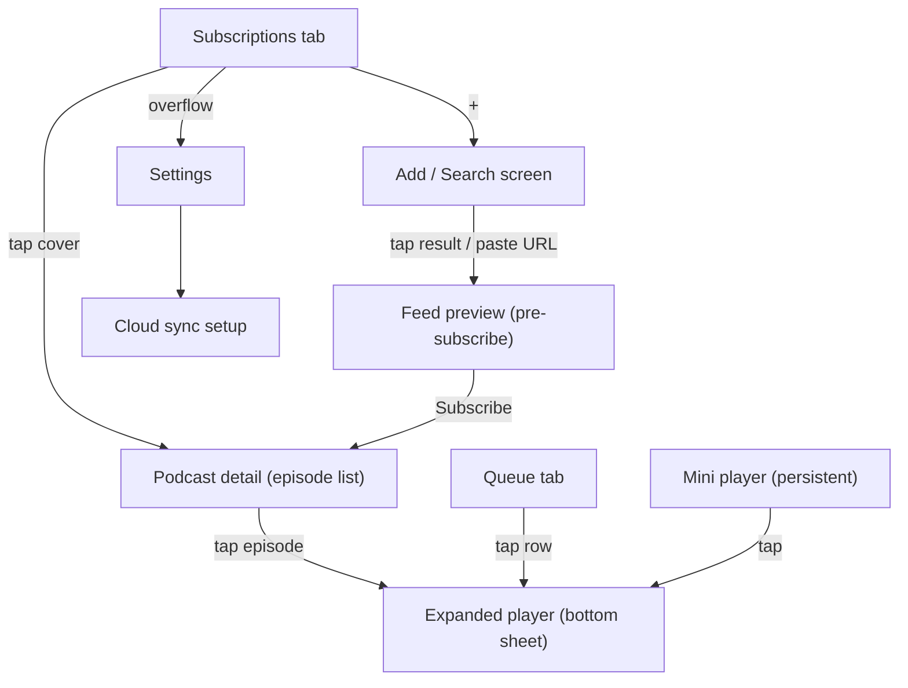
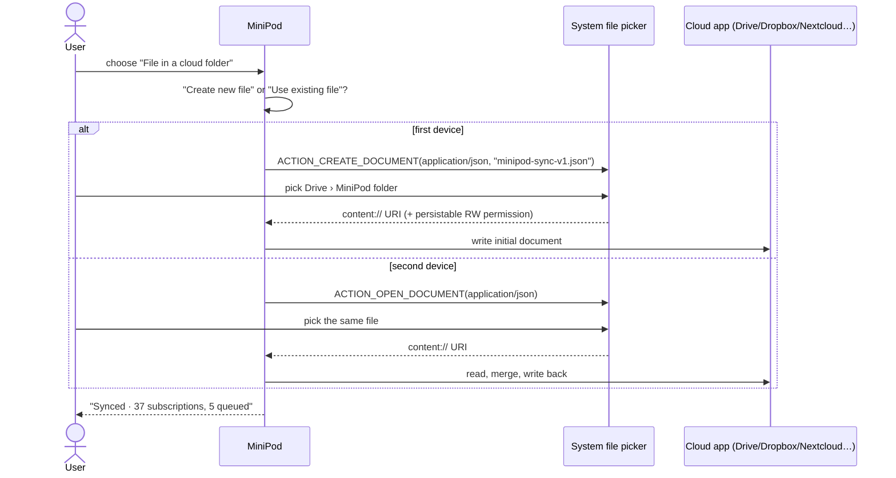

# MiniPod — Product & UX Design

> An ultra-minimalist podcast player for **Android and the PC (macOS / Linux / Windows) as a local Web App**: **all of AntennaPod's discovery & feed sources, one-tenth of its UI**, plus zero-cost cloud file sync between all your devices. One React UI, one TypeScript core, two thin hosts (Kotori-style monorepo, zero native Node addons).
>
> Companion document: [ARCHITECTURE.md](ARCHITECTURE.md) (modules, interfaces, DB schema, sync schema & merge algorithm).
> Source inventory of AntennaPod: [docs/ANTENNAPOD_SOURCES.md](docs/ANTENNAPOD_SOURCES.md).

---

## 1. Product principles

| # | Principle | Consequence |
|---|-----------|-------------|
| P1 | **One job: subscribe → queue → listen → resume.** | Every screen must serve one of those four verbs or it is cut. |
| P2 | **Sources are not bloat.** | 100 % of AntennaPod's discovery registries, feed formats, URL schemes, auth, OPML and local folders are kept — they are invisible plumbing behind a single "Add" box. |
| P3 | **State follows the listener, not the device.** | Subscriptions, the queue and millisecond progress sync through a single JSON file in storage the user already owns (Drive, Dropbox, Nextcloud, WebDAV, Gist). No MiniPod server, no account, no cost. |
| P4 | **No configuration before value.** | A fresh install shows Top Charts and a search box. Sync is opt-in and the default path (a file in a folder the user already syncs — SAF on Android, a local synced folder on the PC) needs zero developer credentials. |
| P5 | **Nothing automatic that the user did not ask for.** | No auto-download rule engine, no smart inbox, no "new episodes" badges. Refresh is pull-to-refresh plus a background refresh of subscriptions only (no downloads). |
| P6 | **Same app on the phone and on the desk.** | Identical features, screens and sync file on Android and PC; only the shell adapts (bottom bar + sheets on phones, navigation rail + player bar on wide windows). |

## 2. Scope

### 2.1 Kept (and why)

| Capability | AntennaPod origin | MiniPod form |
|---|---|---|
| Search across Apple Podcasts, PodcastIndex, fyyd, gpodder.net, combined/federated search | `net/discovery` (`PodcastSearcherRegistry`, `CombinedSearcher`, `ItunesPodcastSearcher`, `PodcastIndexPodcastSearcher`, `FyydPodcastSearcher`; gpodder.net searcher existed in older releases) | One search box, one merged result list, optional "source" filter chip |
| Apple Top Charts (per country) | `ItunesTopListLoader` | Default content of the empty Add screen |
| Paste any URL: RSS 2.0 / 0.91 / 0.92, Atom 1.0, website URL → HTML `<link rel=alternate>` discovery, `itpc://`, `pcast://`, `feed://`, `antennapod-subscribe://`, `subscribeonandroid.com`, `podcasts.apple.com/…/idNNN` lookup | `UrlChecker`, `TypeGetter`, `FeedDiscoverer`, `ItunesPodcastSearcher.lookupUrl` | Same search box; auto-detects URL vs text |
| Namespaces: `itunes`, `podcast` (Podcasting 2.0: chapters, transcript, funding, socialInteract), `content`, `media`, `psc` Simple Chapters, `dc`, `atom` | `parser/feed/namespace/*` | Parser module, feature-complete |
| HTTP Basic Auth feeds & enclosures (401 → credential prompt) | `BasicAuthorizationInterceptor`, `HttpCredentialEncoder` | Inline dialog on the preview screen |
| OPML import / export | `OpmlReader`, `OpmlWriter` | Two rows in Settings; share-sheet/`ACTION_VIEW` intent for `.opml` |
| Local Folder virtual feeds (SAF tree on Android, a directory path on the PC) | `LocalFeedUpdater` | "Add local folder" row in the Add screen overflow |
| Chapters: ID3v2 `CHAP`, Vorbis comment, MP4/M4A `chpl`, Podlove Simple Chapters, Podcasting 2.0 JSON | `parser/media/*`, `PodcastIndexChapterParser`, `ChapterUtils` | Chapter list in the expanded player |
| Streaming & downloaded playback, byte-range seeking, audio & video enclosures | Media3/ExoPlayer in AntennaPod | PC: HTML5 `<audio>`/`<video>` fed by a local Range proxy; Android: native Media3 `MediaSessionService` driven from the UI |
| Speed 0.5×–3.0×, skip −10 s/+30 s, sleep timer | Player controls | Expanded player only |
| Single queue, drag-to-reorder, swipe-to-remove, play-next/add-to-queue, auto-remove on finish | Queue fragment | Queue tab |
| Millisecond progress, resume point, played state | `PlaybackServiceTaskManager` / `DBWriter.setFeedMediaPlaybackInformation` | Progress recorder (local every 5 s, cloud on pause + 3-min checkpoint) |

### 2.2 Cut (explicitly)

| AntennaPod feature | Why it goes |
|---|---|
| Inbox tab & "new" flag workflow | The queue *is* the triage. New episodes appear in the podcast's own list. |
| Favorites tab | Not needed to subscribe/queue/listen/resume. |
| Episodes hub (All / Downloads / History tabs) | Same. "Downloaded" is a filter chip inside a podcast page, not a hub. |
| Statistics, listening-hours charts, year-in-review | Vanity. |
| Auto-download rule engine (per-feed rules, episode cache, global filters, "download new episodes from…") | Replaced by one explicit per-episode download button. No cache management UI. |
| Multiple queues / "queue lock" / "smart shuffle" | One queue. |
| gpodder.net / Nextcloud account sync, Wi-Fi sync | Replaced by cloud **file** sync (no account server). |
| Feed-level playback settings (volume adaptation, per-feed speed, skip intro/outro) | Global speed only. |
| Tags/folders for subscriptions, subscription counters, custom sort menus | Grid sorted by latest episode. |
| Home screen with sections, Echo, notifications per feed, widgets | Cut. (A media-style notification remains — required for background playback.) |
| Per-episode share formats, "shownotes" HTML export | Only "copy feed URL" and "share episode link". |
| Theme pickers, accent colours, swipe-action customisation, drawer customisation | Follows system light/dark + Material You dynamic colour. |

Net result: AntennaPod ships ~12 top-level destinations plus ~70 preference rows; MiniPod ships **2 tabs, 1 add screen, 1 detail screen, 1 player sheet and 1 settings page (9 rows)**.

## 3. Information architecture



Navigation chrome: a 2-item bottom bar (`Subscriptions`, `Queue`) with the mini player docked directly above it. Everything else is pushed on the back-stack or presented as a sheet.

## 4. Screens & wireframes

### 4.1 Subscriptions

```
┌──────────────────────────────────────────┐
│ MiniPod                         ⟳   ⋮    │   ⋮ → Settings
├──────────────────────────────────────────┤
│ ┌──────┐ ┌──────┐ ┌──────┐               │
│ │cover │ │cover │ │cover │   3-col grid, │
│ │      │ │      │ │      │   no badges,  │
│ └──────┘ └──────┘ └──────┘   no counters │
│ ┌──────┐ ┌──────┐                        │   (long-press: Unsubscribe /
│ │cover │ │cover │                        │    Copy feed URL)
│ └──────┘ └──────┘                        │
│                                          │
│                                     (+)  │   FAB → Add / Search
├──────────────────────────────────────────┤
│ ▶ ▮ Episode title · 12:34 / 48:10  ▮▮▮▯▯ │   mini player
├──────────────────────────────────────────┤
│      ◉ Subscriptions        ☰ Queue      │
└──────────────────────────────────────────┘
```

- Order: most-recent episode first (not configurable). Grid ⇄ list toggle in ⋮ (the only view option). Covers carry no unread badges or counters (P5): the podcast page and the queue are where new episodes are seen.
- Pull-to-refresh refreshes all feeds. ⟳ in the app bar does the same with a progress indicator.
- Empty state: "No subscriptions yet" + primary button *Find podcasts* → Add screen.

### 4.2 Add / Search (unified)

```
┌──────────────────────────────────────────┐
│ ←  🔍 Search or paste a feed / site URL  │
├──────────────────────────────────────────┤
│  All  Apple  PodcastIndex  fyyd  gpodder │   source chips (All = CombinedSearcher)
├──────────────────────────────────────────┤
│  Top podcasts · 🇩🇪 Germany ▾            │   iTunes top charts (country picker)
│  ┌────┐ Title                            │
│  │    │ Author                           │
│  └────┘                                  │
│  …                                       │
├──────────────────────────────────────────┤
│  ⋮  Import OPML · Add local folder       │   overflow
└──────────────────────────────────────────┘
```

Behaviour of the single input box:

1. Text that is **not a URL** → federated search (`CombinedSearcher` semantics: all providers in parallel, results weighted & de-duplicated by feed URL). Each row shows title, author and a tiny provider badge.
2. Text that **is a URL** (or `itpc://`, `pcast:`, `feed://`, `antennapod-subscribe://`, `podcasts.apple.com/...`, `subscribeonandroid.com/...`): → "Open feed" row appears immediately above results. Tapping runs the resolve pipeline (scheme rewrite → iTunes lookup → fetch → type detection → HTML `<link>` discovery → choose-one dialog if several feeds).
3. Deep links from other apps (`ACTION_VIEW` on `itpc`/`pcast`/`feed`/`http(s)` with RSS mime, `.opml` files, `ACTION_SEND` text) land here with the box pre-filled and the resolve pipeline already running.

### 4.3 Feed preview (pre-subscribe)

```
┌──────────────────────────────────────────┐
│ ←                                        │
│  ┌──────┐  Podcast title                 │
│  │cover │  Author · 213 episodes         │
│  └──────┘  [ Subscribe ]                 │
│  Description (3 lines, expandable)       │
├──────────────────────────────────────────┤
│  Latest episode title            ▶ 42m   │   tap ▶ streams without subscribing
│  Second episode                  ▶ 38m   │
└──────────────────────────────────────────┘
```

- 401 from the feed → inline *Username / Password* fields appear under the URL with a *Retry* button (HTTP Basic Auth). Credentials are stored encrypted on this device only and sent for feed and enclosure requests of the same host; they are never written to the sync file (other devices prompt once).
- Multiple `<link rel="alternate">` feeds on a website → simple radio list "Which feed?".
- Playing from the preview creates a hidden *feed stub* (not shown in Subscriptions) so the episode can be queued, tracked and synced; the stub disappears once nothing of that podcast is queued or in progress. Tapping ▶ on a preview episode therefore behaves exactly like playing a subscribed one.
- Podcasts whose Apple lookup lacks a feed URL are resolved through a title+author search across the other directories (AntennaPod's fallback); only if that fails does the user see "Podcast not found".

### 4.4 Podcast detail (episode list)

```
┌──────────────────────────────────────────┐
│ ←  Podcast title                    ⋮    │   ⋮ → Refresh · Unsubscribe · Copy URL · Website
│  ┌────┐ Author                           │
│  └────┘ Description ▾                    │
│  [ All ] [ Unplayed ] [ Downloaded ]     │   3 filter chips, nothing else
├──────────────────────────────────────────┤
│  30 Oct · 48 min                         │
│  Episode title                           │
│  ▮▮▮▮▮▯▯▯▯▯ 23:11 left        ▶  ⬇  ⋮   │   ⋮ → Play next · Add to queue · Mark played/unplayed · Share link
│──────────────────────────────────────────│
│  27 Oct · 35 min                  ✓      │   ✓ = played (greyed)
│  Episode title                   ▶  ⬇  ⋮ │
└──────────────────────────────────────────┘
```

- Swipe right on a row = *Add to queue* (undo snackbar). That is the only swipe action.
- ⬇ toggles a manual download (stream when not downloaded). No batch download, no auto rules.
- Long-press ▶ = *Play next*.
- Feeds that paginate (Atom `rel="next"`) show a plain *Load older episodes* footer; nothing is fetched automatically beyond the first page.

### 4.5 Queue

```
┌──────────────────────────────────────────┐
│ Queue · 5 episodes · 3h 12m         ⋮    │   ⋮ → Clear queue · Refresh
├──────────────────────────────────────────┤
│ ≡ ┌──┐ Episode title                     │   ≡ drag handle (long-press also drags)
│   └──┘ Podcast · 48 min · ▮▮▮▯▯▯▯    ▶   │
│ ≡ ┌──┐ Episode title                     │   swipe left/right = remove (undo)
│   └──┘ Podcast · 35 min              ▶   │
│ …                                        │
├──────────────────────────────────────────┤
│ ▶ ▮ Episode title · 12:34 / 48:10  ▮▮▮▯▯ │
├──────────────────────────────────────────┤
│      ○ Subscriptions        ◉ Queue      │
└──────────────────────────────────────────┘
```

Queue semantics (single source of truth, synced):

- Playing an episode from anywhere puts it at the **head** of the queue if it is not already queued.
- When an episode finishes it is marked **played**, removed from the queue, and the next head starts (auto-advance). Sleep-timer expiry pauses instead.
- *Play next* inserts at position 1 (right after the current item); *Add to queue* appends.
- Empty state: "Nothing queued. Add episodes from any podcast."

### 4.6 Mini player & expanded player

Mini player (always visible when something is loaded, in every screen):

```
┌──────────────────────────────────────────┐
│ ▶/⏸  ▮ Episode title · 12:34 / 48:10     │   tap anywhere else → expand
│ ▮▮▮▮▮▮▮▯▯▯▯▯▯▯▯▯▯▯▯▯▯▯▯▯▯▯▯▯▯▯▯▯▯▯▯▯▯▯▯▯ │   1-dp progress line
└──────────────────────────────────────────┘
```

Expanded player (modal bottom sheet, full height):

```
┌──────────────────────────────────────────┐
│ ⌄                               ⏾  1.5× │   sleep timer · speed
│                                          │
│            ┌────────────────┐            │
│            │                │            │   cover art, or video surface
│            │   cover art    │            │   for video enclosures
│            │                │            │
│            └────────────────┘            │
│                                          │
│  Episode title                           │
│  Podcast name                            │
│                                          │
│  12:34  ━━━━━━━━●───────────────  -35:36 │   seek bar (chapter ticks when present)
│                                          │
│        ⟲10        ⏸         30⟳          │
│                                          │
│  ▸ Chapters (12)                         │   collapsible list: start · title; tap = seek
│  ▸ Shownotes                             │   collapsible rendered HTML
└──────────────────────────────────────────┘
```

Controls and their fixed behaviour:

| Control | Behaviour |
|---|---|
| ⟲10 / 30⟳ | Seek −10 000 ms / +30 000 ms (fixed; no preference) |
| Speed | Tap cycles presets 1.0 → 1.25 → 1.5 → 1.75 → 2.0 → 1.0; long-press opens a slider 0.5×–3.0× in 0.05 steps. Global, persisted locally (not synced). |
| ⏾ Sleep timer | Sheet with 15 / 30 / 45 / 60 min, *End of episode*, *End of chapter*, *Off*. Last-minute fade-out. On Android the timer runs inside the native playback service, so it works with the screen off. Shake-to-extend is **not** included. |
| Chapters | All sources are merged (feed PSC + embedded ID3/Vorbis/MP4 + Podcasting 2.0 JSON, same 1-second alignment rule as AntennaPod's `ChapterMerger`). Current chapter highlighted; chapter image replaces cover while active. |
| Media notification / lockscreen / Bluetooth / Android Auto / desktop media keys | Android: Media3 `MediaSession`; PC: `navigator.mediaSession` (OS media overlay, keyboard media keys). Same play/pause/−10/+30 actions. |

### 4.6b PC Web App shell (window ≥ 840 px)

The same screens rearranged for a wide window; nothing is added.

```
┌────┬────────────────────────────────────────────────────────────┬──────────────────┐
│ +  │ Subscriptions                                     ⟳        │ Chapters      ✕  │
│    │ ┌────┐ ┌────┐ ┌────┐ ┌────┐ ┌────┐ ┌────┐                 │ 00:00 Intro      │
│ ▦  │ │    │ │    │ │    │ │    │ │    │ │    │   6-col grid      │ 04:12 News    ◀  │
│Subs│ └────┘ └────┘ └────┘ └────┘ └────┘ └────┘                 │ 18:40 Interview  │
│    │ ┌────┐ ┌────┐ ┌────┐                                       │ …                │
│ ☰  │ │    │ │    │ │    │                                       │                  │
│Queue└────┘ └────┘ └────┘                                        │ (side sheet,     │
│    │                                                            │  toggled from    │
│ ⚙  │                                                            │  the player bar) │
│Sett│                                                            │                  │
├────┴────────────────────────────────────────────────────────────┴──────────────────┤
│ ┌──┐ Episode title · Podcast     ⟲10  ⏸  30⟳   12:34 ━━━━━●──────── -35:36  1.5× ⏾ ≡ │
└───────────────────────────────────────────────────────────────────────────────────┘
```

- Left **navigation rail**: FAB *Add*, then *Subscriptions*, *Queue*, *Settings* (Settings gets a rail slot because there is room; on phones it stays in the overflow).
- **Persistent player bar** at the bottom replaces mini player + expanded sheet: every expanded-player control is inline; cover click opens shownotes in the side sheet; `≡` toggles the *Chapters* side sheet. Video enclosures play in a resizable pane above the bar.
- Podcast detail and Feed preview open in the content pane; Queue supports mouse drag and keyboard reordering (`Alt+↑/↓`).
- Below 840 px (narrow browser window) the PC Web App falls back to the phone shell above, so both layouts are exercised everywhere.

### 4.7 Settings (the whole page)

```
Downloads
  Delete download when played ……………… (on)
Cloud sync
  Status: Synced 2 min ago via Google Drive (AppData)   [Sync now]
  Provider ………………………………… None / File in a cloud folder / Google Drive / WebDAV / GitHub Gist
  Sync only on Wi-Fi …………………… (off)
  This device name ……………………… Pixel 8
Subscriptions
  Import OPML…
  Export OPML…
  Refresh in background …………… every 3 h
About
  Version · Licences · Source code
```

Nine rows. Nothing is added without removing something else. Deliberately absent: audio-focus/ducking and Bluetooth-disconnect options (Media3 with `C.AUDIO_CONTENT_TYPE_SPEECH` and `handleAudioFocus = true` pauses rather than ducks and pauses on `becomingNoisy` by default), storage location (internal app storage only), theme, swipe and notification customisation.

## 5. Playback progress model (user-visible rules)

| Event | Local DB | Cloud |
|---|---|---|
| Position tick while playing | every 5 s (ms-accurate), plus on every seek | at most once per 180 s (coalesced "checkpoint"; a crash costs ≤ 5 s locally, ≤ 3 min on other devices) |
| Pause / stop / app to background / headset disconnect | immediately | immediately (debounced 2 s) |
| Episode completes (`ended` event, or `position ≥ duration − 1 s` with a known duration) | `state=PLAYED`, `position=0`, `playedAt=now`, queue tombstone | immediately |
| Mark played / unplayed manually | immediately | debounced 2 s |
| App resume / open episode | — | pull first; if remote progress for the *current* episode is newer, show snackbar "Resumed from Pixel Tablet at 23:11 — Undo" and seek |

Resume rule: an episode with `state=IN_PROGRESS` resumes at `positionMs` minus a 3 s rewind (not applied when < 3 s in). `PLAYED` episodes restart at 0.

## 6. Cloud File Auto-Sync — user experience

### 6.1 What syncs

| Synced | Not synced (device-local) |
|---|---|
| Subscriptions (feed URL, title, cover hint, auth-required flag, add/remove time) | Feed credentials — never written to the file; each device prompts once |
| Queue (membership + order) | Downloaded files |
| Episode progress (ms position, duration, played state, timestamps) | Playback speed, sleep timer, UI toggles |
| Device registry (names, last seen) | Local-folder feeds and their progress (paths are device-specific) |

### 6.2 Provider choice (one screen, radio list)

```
┌──────────────────────────────────────────┐
│ ←  Cloud sync                            │
│                                          │
│ ( ) Off                                  │
│ (•) File in a cloud folder  — recommended│
│      Android: pick a sync file with the  │
│      system picker (Dropbox, Nextcloud,  │
│      Syncthing, OneDrive, …).            │
│      PC: pick a folder your Drive/Dropbox│
│      /Syncthing/iCloud client already    │
│      syncs. No sign-in to MiniPod.       │
│ ( ) Google Drive                         │
│      Sign in with Google. Hidden app     │
│      file, works on all your devices.    │
│ ( ) WebDAV                               │
│      URL · username · password           │
│ ( ) GitHub Gist                          │
│      Personal access token (gist scope)  │
│                                          │
│ Sync only on Wi-Fi                 (off) │
│ Device name                   [Pixel 8 ] │
│                                          │
│ Last sync: 2 min ago · remote rev 418    │
│ [ Sync now ]              [ Reset… ]     │
└──────────────────────────────────────────┘
```

Provider availability per platform (the same file format everywhere, so any mix of devices can share one file):

| Provider | Android | PC Web App | Needs from the user |
|---|---|---|---|
| File in a cloud folder | SAF document picker (`ACTION_OPEN/CREATE_DOCUMENT`) inside Dropbox / Nextcloud / Syncthing / OneDrive / FolderSync | Folder browser → a folder synced by the Google Drive / Dropbox / Syncthing / iCloud / OneDrive **desktop client**; MiniPod watches the file for changes | nothing but an installed sync client |
| Google Drive | Google sign-in via Play Services (hidden when unavailable) | Google sign-in in the browser (loopback OAuth, PKCE) | a Google account |
| WebDAV | ✔ | ✔ | file URL + user + app-password |
| GitHub Gist | ✔ | ✔ | fine-grained PAT (`gist`) |

Three UX rules on this screen:

- The *Google Drive* row is shown only when the host can sign in (Android: Play Services + OAuth client in the build; PC: always). On Android, Google Drive users should prefer this row over picking a Drive file via SAF: the Drive `DocumentsProvider` caches aggressively and uploads lazily, so cross-device latency is minutes to hours. On the PC, picking the Drive desktop client's folder is fine — the client uploads within seconds.
- Changing provider never deletes data: the new provider's existing file (if any) is merged with the local state on first sync.
- The status line tells the truth about background behaviour: PC *"Syncs while MiniPod is running, even with this window closed"*; Android *"Syncs while MiniPod is open or playing"*.

### 6.3 Flow A — File in a cloud folder (zero OAuth setup)

**Android (SAF document):**



Notes for the user, shown inline: *"Your cloud app must be installed and allowed to sync this folder. Dropbox/Nextcloud/Syncthing upload the file in the background; it usually appears on other devices within a minute. For Google Drive, prefer the Google Drive option above."*

**PC Web App (local synced folder):**

1. *Choose folder…* opens MiniPod's own folder browser (the server lists directories; no browser file-system permission needed). Typical picks: `~/Google Drive/My Drive/MiniPod`, `~/Dropbox/Apps/MiniPod`, `~/Sync/MiniPod` (Syncthing), `~/Library/Mobile Documents/com~apple~CloudDocs/MiniPod` (iCloud).
2. MiniPod creates `minipod-sync-v1.json` there if missing, or merges with the existing one — which is exactly the file the phone wrote through SAF, so a phone + laptop pair needs **no account at all**.
3. The server watches the file; when the sync client drops a newer version, MiniPod merges within seconds. Writes are atomic (`.tmp` + rename) so the sync client never uploads a half-written file.

### 6.4 Flow B — Google Drive AppData

1. Tap *Google Drive* → Google sign-in for scope `drive.appdata` (Android: Credential Manager + `AuthorizationClient`; PC: the browser opens Google's consent page and returns to `127.0.0.1` — the server completes the PKCE exchange and keeps the refresh token in a `0600` file). MiniPod ships its own OAuth client IDs.
2. MiniPod looks for `minipod-sync-v1.json` in `appDataFolder`; creates it if absent; merges otherwise.
3. Status row shows the Google account; *Reset…* offers "Disconnect" and "Delete cloud data".

Why offered despite needing an OAuth client: it is invisible to the user, survives reinstalls, needs no Drive app or desktop client installed, and is the easiest way to pair an Android phone with a PC that has no sync client.

### 6.5 Flow C — WebDAV / GitHub Gist

- WebDAV: URL of a *file* (`https://cloud.example.org/remote.php/dav/files/me/minipod-sync-v1.json`), username, app password. MiniPod `PROPFIND`s once to validate, then uses `GET` with `If-None-Match` and `PUT` with `If-Match`.
- Gist: paste a PAT with `gist` scope; MiniPod creates a **secret** gist named `minipod-sync-v1.json` (or accepts an existing gist ID). Secret gists are unlisted, not private — the inline help says so (which is also why credentials never enter the file).

### 6.6 What the user sees when two devices disagree

Nothing, in the common case. Merge is per entity (see [ARCHITECTURE.md §7](ARCHITECTURE.md#7-sync-document-minipod-sync-v1json)) so:

| Scenario | Outcome |
|---|---|
| Phone reorders the queue offline; tablet adds an episode offline | Both: tablet's episode is inserted at its position, phone's order kept for everything else. |
| Phone unsubscribes from X; tablet (offline for a week) still has X | X stays unsubscribed everywhere (tombstone wins while it is newer than the tablet's last *change* to X). Re-subscribing later on either device wins over the old tombstone. |
| Tablet is switched on after a year | Its untouched copies of long-deleted subscriptions are *not* resurrected (they fall under the sync file's tombstone floor); anything it changed while offline is kept and pushed. |
| Tablet queued an episode of a podcast the phone never fetched (or that already dropped off the feed) | Phone shows and can stream it immediately: queue entries carry a small title/enclosure stub. |
| Both devices listened to the same episode | Newest timestamp wins; on an identical timestamp "played" wins, then the farther position. |
| Phone finished the episode; tablet paused it earlier at 20 min | Played wins (it is the newer write); the tablet shows ✓ and drops it from the queue. |

The only user-facing conflict UI is the *Resumed from <device> — Undo* snackbar when the position of the episode currently on screen jumps because of a pull.

### 6.7 Battery & quota budget

- Playing for 1 h with the default policy = **≤ 20 uploads** (one checkpoint per 180 s window, only if the position moved and nothing else was pushed in that window). Each pause/stop adds one immediate upload; local progress is still saved every 5 s. The 3-minute cadence keeps the mobile radio out of permanent tail state, avoids a Gist commit every half minute, and gives SAF-backed cloud apps (Dropbox/Nextcloud watchers) time to upload between writes instead of producing conflicted copies.
- Idle device: a 15-min periodic pull (PC: in the always-on local server; Android: while the app is open or playing) plus a file watcher for folder-based providers; skipped when the remote ETag is unchanged (HEAD/`If-None-Match`, or Drive `files.get?fields=md5Checksum`). A pull that changes nothing locally never triggers an upload, so idle devices do not ping-pong.
- Drive free quota is 20 000 queries/100 s per project — a single user is three orders of magnitude below.

## 7. Accessibility & platform notes

- All tap targets ≥ 48 dp; row actions also in the ⋮ menu (drag/swipe have menu equivalents: *Move to top*, *Remove*).
- Dynamic type supported; the mini player grows to two lines rather than truncating.
- Media controls expose `contentDescription`s identical to the labels above; the seek bar is a `Slider` with chapter `stateDescription`.
- **Android**: 8.0+ (API 26); standalone Capacitor APK; audio runs in a native foreground `MediaSessionService` so playback, 5 s progress saving and pause/3-min cloud sync keep working with the screen off; system back gesture closes sheets/dialogs/routes in order (`window.__minipodHandleBack`); edge-to-edge with safe-area insets; `READ_MEDIA_*` not required (SAF only).
- **PC Web App**: `minipod` starts a loopback server (`127.0.0.1`, Node ≥ 22.5, no native addons, no install beyond Node) and opens the UI in a Chromium `--app` window or the default browser; the server keeps refreshing feeds and syncing while the window is closed. Keyboard: `Space` play/pause, `←/→` −10/+30 s, `Shift+←/→` chapters, `[`/`]` speed, `/` search. Plays in Chrome, Edge, Firefox, Safari.
- **Shared**: subscriptions, queue and progress are the same on every device through the sync file; a phone and a laptop pointed at the same Dropbox/Drive/Syncthing folder (or the same Drive account / WebDAV / Gist) stay in step.

## 8. Decisions log (resolved with the critic)

1. **Downloads** — keep the manual per-episode ⬇ and the single *Delete download when played* toggle; no storage-location setting (internal app storage only), no batch or automatic downloads.
2. **Local Folder feeds** — remain device-local; their progress is not synced in v1 (file-name-keyed sync is a v2 candidate).
3. **gpodder.net search** — kept as an opt-in source chip with weight 0 in the combined search (AntennaPod removed its searcher in #7047 because the public instance is unreliable).
4. **Credentials** — never synced; `hasCredentials` only makes other devices prompt once.
5. **Cloud checkpoint while playing** — 180 s (local DB every 5 s; immediate on pause/stop/complete/queue edit).
6. **Platforms** — Android (Capacitor APK with native Media3 playback) and PC Web App (Node loopback server + browser) from one TypeScript monorepo; no iOS in v1; no Electron (the browser `--app` window is enough and keeps the install at "have Node").
7. **Video on Android** — v1 plays the audio track natively, shows an *audio only* badge on video episodes and offers *Open in video player*; an inline video surface is a P2 follow-up (PC plays video inline from day one).
8. **Screen-off correctness on Android** — queue auto-advance, sleep timer, 5 s position checkpoint and a completion journal all live in the native playback service; the UI only reconciles. Pausing with the screen off still uploads progress immediately (bounded 15 s wake lock).
